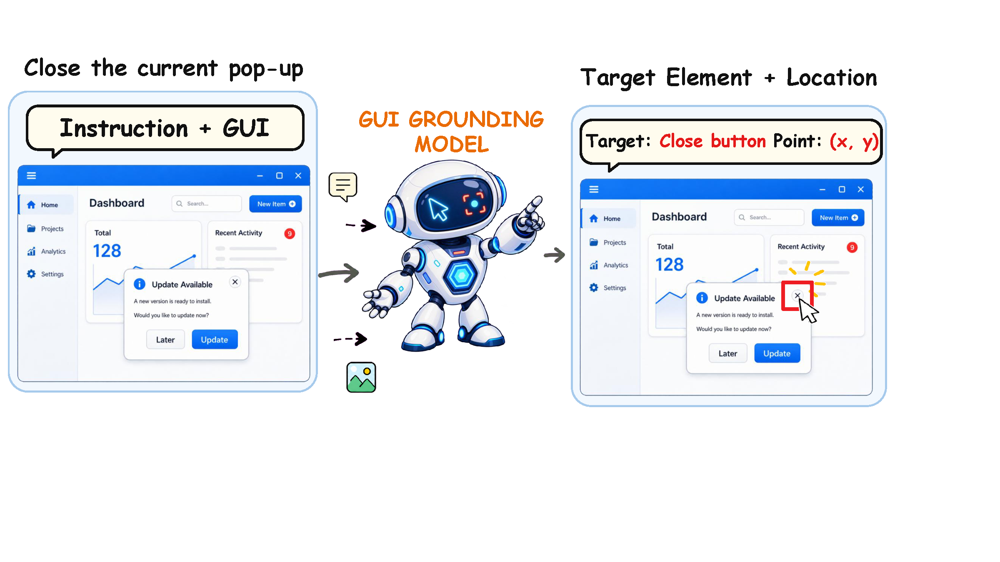
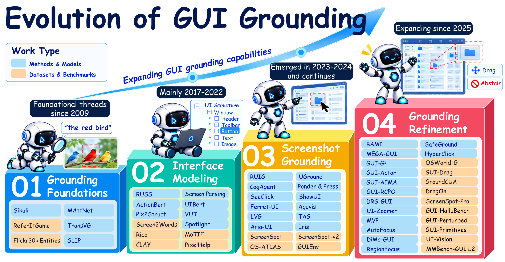
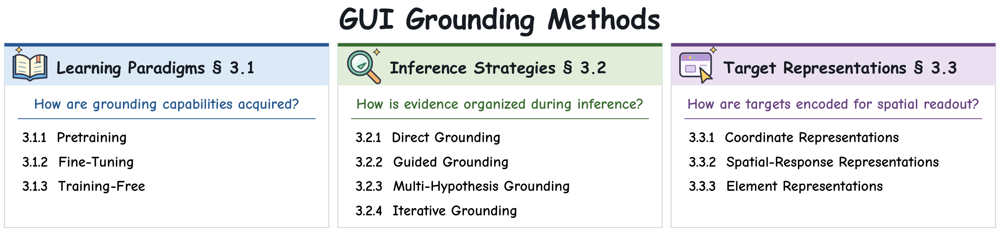
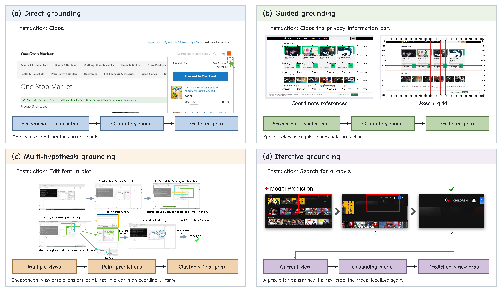
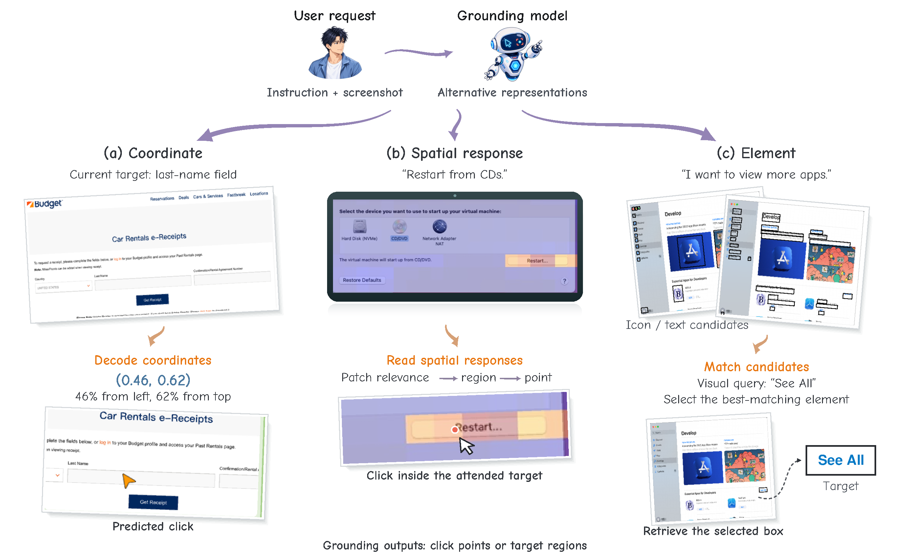
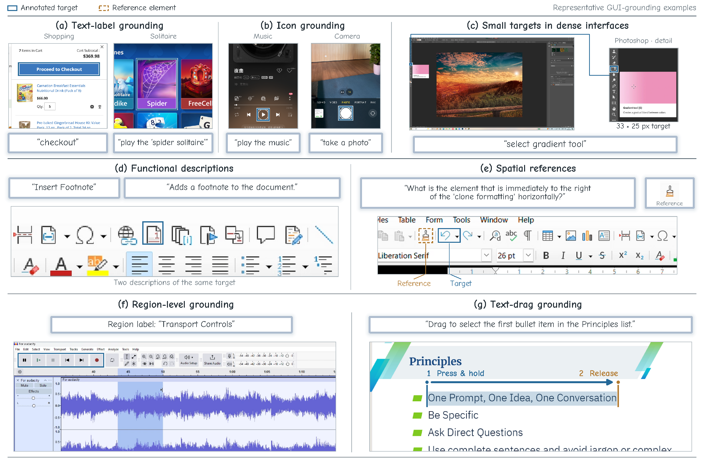

<div align="center">

<p>
<a href="assets/overview.png"></a>
</p>

# GUI Grounding for Computer-Use Agents: A Survey

**Methods · Datasets · Benchmarks · Evaluation**

<p>
<a href="https://github.com/OmniAI-Lab-CUHKSZ/Awesome-GUI-Grounding/stargazers"></a>


<a href="references.bib"></a>
</p>

<p>
<a href="#learning-paradigms">Learning</a> ·
<a href="#inference-strategies">Inference</a> ·
<a href="#target-representations">Representations</a> ·
<a href="#datasets-and-evaluation">Datasets &amp; Benchmarks</a> ·
<a href="#citation">Citation</a>
</p>

</div>

<a id="news"></a>

## 📰 News

- **[2026/11]** We release **Awesome-GUI-Grounding**, a curated collection of papers, datasets, and benchmarks for GUI grounding.

---

<a id="introduction"></a>

## 📖 Introduction

Official repository for **GUI Grounding for Computer-Use Agents: A Survey**. GUI grounding connects an agent’s task understanding to concrete interface actions: given a screenshot and an instruction, a model identifies the target element and predicts where to act. This collection covers the methods, datasets, and benchmarks behind that capability.

GUI grounding has evolved from visual grounding and interface modeling toward screenshot-based localization, visual search, and iterative refinement. The roadmap below traces these developments.

<div align="center">
<a href="assets/history-roadmap.png"></a>
</div>

<a id="table-of-contents"></a>

## 🗂️ Table of Contents

<details>
<summary><b>Explore the collection</b></summary>

- [Method Taxonomy](#method-taxonomy)
- [Learning Paradigms](#learning-paradigms)
  - [General Pretraining](#general-pretraining)
  - [GUI Grounding Pretraining](#gui-grounding-pretraining)
  - [Supervised Fine-Tuning](#supervised-fine-tuning)
  - [Reinforcement Learning](#reinforcement-learning)
  - [On-Policy Distillation](#on-policy-distillation)
  - [Training-Free](#training-free)
- [Inference Strategies](#inference-strategies)
  - [Direct Grounding](#direct-grounding)
  - [Guided Grounding](#guided-grounding)
  - [Multi-Hypothesis Grounding](#multi-hypothesis-grounding)
  - [Iterative Grounding](#iterative-grounding)
- [Target Representations](#target-representations)
  - [Coordinate Representations](#coordinate-representations)
  - [Spatial-Response Representations](#spatial-response-representations)
  - [Element Representations](#element-representations)
- [Datasets and Evaluation](#datasets-and-evaluation)
  - [Training Data and Resources](#training-data-and-resources)
  - [Evaluation Benchmarks](#evaluation-benchmarks)
  - [GUI Agent Benchmarks and Environments](#gui-agent-benchmarks-and-environments)
- [Foundations and Related GUI Agents](#foundations-and-related-gui-agents)
- [Related Surveys](#related-surveys)
- [Citation](#citation)

</details>

---

<a id="method-taxonomy"></a>

## 🧩 Method Taxonomy

The survey organizes GUI grounding methods along three complementary dimensions: [learning paradigms](#learning-paradigms) describe how grounding capabilities are acquired, [inference strategies](#inference-strategies) describe how evidence is organized, and [target representations](#target-representations) describe how interaction targets are encoded. The paper lists below follow these dimensions.

<div align="center">
<a href="assets/method-framework.png"></a>
</div>

<a id="learning-paradigms"></a>

## 🧠 Learning Paradigms

<a id="general-pretraining"></a>

### General Pretraining

- **`Resource 2026`** GPT-6 Astra: A New Generation of Intelligence. [[resource](https://openai.com/index/gpt-6-astra/)]
- **`CVPR 2026`** Molmo2: Open Weights and Data for Vision-Language Models with Video Understanding and Grounding. [[paper](https://arxiv.org/abs/2601.10611)]
- **`Resource 2026`** Qwen3.5: Towards Native Multimodal Agents. [[resource](https://qwen.ai/blog?id=qwen3.5)]
- **`arXiv 2026`** STEP3-VL-10B Technical Report. [[paper](https://arxiv.org/abs/2601.09668)]
- **`Resource 2026`** System Card: Claude Opus 4.8. [[resource](https://www-cdn.anthropic.com/0f0c97ad20d8005706296bd92aa1c27c6b2f4f61.pdf)]
- **`arXiv 2025`** Gemini 2.5: Pushing the Frontier with Advanced Reasoning, Multimodality, Long Context, and Next Generation Agentic Capabilities. [[paper](https://arxiv.org/abs/2507.06261)]
- **`arXiv 2025`** GLM-4.5V and GLM-4.1V-Thinking: Towards Versatile Multimodal Reasoning with Scalable Reinforcement Learning. [[paper](https://arxiv.org/abs/2507.01006)]
- **`arXiv 2025`** InternVL3.5: Advancing Open-Source Multimodal Models in Versatility, Reasoning, and Efficiency. [[paper](https://arxiv.org/abs/2508.18265)]
- **`arXiv 2025`** Kimi-VL Technical Report. [[paper](https://arxiv.org/abs/2504.07491)]
- **`arXiv 2025`** MiMo-VL Technical Report. [[paper](https://arxiv.org/abs/2506.03569)]
- **`CVPR 2025`** Molmo and PixMo: Open Weights and Open Data for State-of-the-Art Vision-Language Models. [[paper](https://arxiv.org/abs/2409.17146)]
- **`arXiv 2025`** Qwen2.5-VL Technical Report. [[paper](https://arxiv.org/abs/2502.13923)] [[code](https://github.com/QwenLM/Qwen2.5-VL)]
- **`arXiv 2025`** Qwen3-VL Technical Report. [[paper](https://arxiv.org/abs/2511.21631)]
- **`arXiv 2025`** Seed1.5-VL Technical Report. [[paper](https://arxiv.org/abs/2505.07062)]
- **`Resource 2024`** Developing a Computer Use Model. [[resource](https://www.anthropic.com/news/developing-computer-use)]
- **`arXiv 2024`** GPT-4o System Card. [[paper](https://arxiv.org/abs/2410.21276)]
- **`ICLR 2024`** Grounding Multimodal Large Language Models to the World. [[paper](https://openreview.net/forum?id=lLmqxkfSIw)]
- **`arXiv 2023`** GPT-4 Technical Report. [[paper](https://arxiv.org/abs/2303.08774)]
- **`arXiv 2023`** Qwen-VL: A Versatile Vision-Language Model for Understanding, Localization, Text Reading, and Beyond. [[paper](https://arxiv.org/abs/2308.12966)]
- **`CVPR 2022`** Grounded Language-Image Pre-Training. [[paper](https://openaccess.thecvf.com/content/CVPR2022/html/Li_Grounded_Language-Image_Pre-Training_CVPR_2022_paper.html)]

<a id="gui-grounding-pretraining"></a>

### GUI Grounding Pretraining

- **`arXiv 2026`** Covering Human Action Space for Computer Use: Data Synthesis and Benchmark. [[paper](https://arxiv.org/abs/2605.12501)]
- **`arXiv 2026`** GUICrafter: Weakly-Supervised GUI Agent Leveraging Massive Unannotated Screenshots. [[paper](https://arxiv.org/abs/2606.29705)]
- **`arXiv 2026`** Scaling GUI Agents with Visual State Transitions. [[paper](https://arxiv.org/abs/2607.24112)]
- **`arXiv 2026`** StepX-Edge: An On-Device UI Vision-Language Model via Architecture-Training-Deployment Co-Design. [[paper](https://arxiv.org/abs/2607.22708)]
- **`ICML 2025`** Aguvis: Unified Pure Vision Agents for Autonomous GUI Interaction. [[paper](https://proceedings.mlr.press/v267/xu25ae.html)]
- **`ACL Findings 2025`** Aria-UI: Visual Grounding for GUI Instructions. [[paper](https://arxiv.org/abs/2412.16256)]
- **`ICLR 2025`** Grounding Multimodal Large Language Model in GUI World. [[paper](https://proceedings.iclr.cc/paper_files/paper/2025/hash/31fc85f7461ce71eadf27fb7281973bd-Abstract-Conference.html)]
- **`ACL 2025`** GUICourse: From General Vision Language Model to Versatile GUI Agent. [[paper](https://aclanthology.org/2025.acl-long.1065/)]
- **`arXiv 2025`** MagicGUI: A Foundational Mobile GUI Agent with Scalable Data Pipeline and Reinforcement Fine-tuning. [[paper](https://arxiv.org/abs/2508.03700)]
- **`CVPR 2025`** Magma: A Foundation Model for Multimodal AI Agents. [[paper](https://arxiv.org/abs/2502.13130)]
- **`ICLR 2025`** Navigating the Digital World as Humans Do: Universal Visual Grounding for GUI Agents. [[paper](https://arxiv.org/abs/2410.05243)] [[code](https://github.com/OSU-NLP-Group/UGround)]
- **`ICLR 2025`** OS-ATLAS: A Foundation Action Model for Generalist GUI Agents. [[paper](https://arxiv.org/abs/2410.23218)] [[code](https://github.com/OS-Copilot/OS-Atlas)]
- **`CVPR 2025`** SpiritSight Agent: Advanced GUI Agent with One Look. [[paper](https://arxiv.org/abs/2503.03196)]
- **`EMNLP 2025`** UI-Hawk: Unleashing the Screen Stream Understanding for Mobile GUI Agents. [[paper](https://aclanthology.org/2025.emnlp-main.920/)]
- **`arXiv 2025`** UI-TARS: Pioneering Automated GUI Interaction with Native Agents. [[paper](https://arxiv.org/abs/2501.12326)] [[code](https://github.com/bytedance/UI-TARS)]
- **`ICCV 2025`** UIPro: Unleashing Superior Interaction Capability For GUI Agents. [[paper](https://arxiv.org/abs/2509.17328)]
- **`CVPR 2024`** CogAgent: A Visual Language Model for GUI Agents. [[paper](https://arxiv.org/abs/2312.08914)] [[code](https://github.com/THUDM/CogAgent)]
- **`IJCAI 2024`** ScreenAI: A Vision-Language Model for UI and Infographics Understanding. [[paper](https://ijcai.org/proceedings/2024/339)]
- **`ACL 2024`** SeeClick: Harnessing GUI Grounding for Advanced Visual GUI Agents. [[paper](https://arxiv.org/abs/2401.10935)] [[code](https://github.com/njucckevin/SeeClick)]
- **`ICLR 2023`** Spotlight: Mobile UI Understanding using Vision-Language Models with a Focus. [[paper](https://arxiv.org/abs/2209.14927)]
- **`EMNLP Findings 2022`** Lexi: Self-Supervised Learning of the UI Language. [[paper](https://arxiv.org/abs/2301.10165)]
- **`arXiv 2021`** UIBert: Learning Generic Multimodal Representations for UI Understanding. [[paper](https://arxiv.org/abs/2107.13731)]

<a id="supervised-fine-tuning"></a>

### Supervised Fine-Tuning

- **`arXiv 2026`** A History-Aware Visually Grounded Critic for Computer Use Agents. [[paper](https://arxiv.org/abs/2606.11078)]
- **`WACV 2026`** AFRAgent: An Adaptive Feature Renormalization Based High Resolution Aware GUI Agent. [[paper](https://openaccess.thecvf.com/content/WACV2026/papers/Anand_AFRAgent__An_Adaptive_Feature_Renormalization_Based_High_Resolution_Aware_WACV_2026_paper.pdf)]
- **`arXiv 2026`** Beyond Binary: Reframing GUI Critique as Continuous Semantic Alignment. [[paper](https://arxiv.org/abs/2605.14311)]
- **`arXiv 2026`** Beyond Clicking:A Step Towards Generalist GUI Grounding via Text Dragging. [[paper](https://arxiv.org/abs/2601.06031)]
- **`arXiv 2026`** BlueLM-GUI Technical Report: A Real-Device-Centric Flywheel for Self-Improving Mobile GUI Agents. [[paper](https://arxiv.org/abs/2609.12394)]
- **`AAAI 2026`** Co-EPG: A Framework for Co-Evolution of Planning and Grounding in Autonomous GUI Agents. [[paper](https://arxiv.org/abs/2511.10705)]
- **`arXiv 2026`** ConClick: Element-Wise Contrastive Learning Improves GUI Grounding. [[paper](https://arxiv.org/abs/2610.13268)] [[code](https://github.com/zhangruotian/ConClick)]
- **`ACL Findings 2026`** D-Artemis: A Deliberative Cognitive Framework for Mobile GUI Multi-Agents. [[paper](https://arxiv.org/abs/2509.21799)]
- **`arXiv 2026`** Decoupling What from Where: How Should a Small GUI Grounding Model Receive the Action Type? [[paper](https://arxiv.org/abs/2610.07444)] [[code](https://github.com/aadcha/action-conditioned-gui-agent)]
- **`CVPR 2026`** Detect Anything via Next Point Prediction. [[paper](https://arxiv.org/abs/2510.12798)]
- **`arXiv 2026`** EvoCUA: Evolving Computer Use Agents via Learning from Scalable Synthetic Experience. [[paper](https://arxiv.org/abs/2601.15876)]
- **`CVPR 2026`** Exposing and Evaluating Hallucinations for GUI Grounding. [[paper](https://openaccess.thecvf.com/content/CVPR2026/papers/Zhang_Exposing_and_Evaluating_Hallucinations_for_GUI_Grounding_CVPR_2026_paper.pdf)]
- **`arXiv 2026`** Fara-1.5: Scalable Learning Environments for Computer Use Agents. [[paper](https://arxiv.org/abs/2606.20785)]
- **`arXiv 2026`** FocusUI: Efficient UI Grounding via Position-Preserving Visual Token Selection. [[paper](https://arxiv.org/abs/2601.03928)]
- **`ECCV 2026`** GAIA: A Data Flywheel System for Training GUI Test-Time Scaling Critic Models. [[paper](https://arxiv.org/abs/2601.18197)]
- **`arXiv 2026`** GoClick: Lightweight Element Grounding Model for Autonomous GUI Interaction. [[paper](https://arxiv.org/abs/2604.23941)]
- **`arXiv 2026`** GroundGUI: GUI Grounding by High-Quality Data and Distillation-to-Reinforcement Learning. [[paper](https://arxiv.org/abs/2610.19100)] [[code](https://github.com/PrentisAI/GroundGUI)]
- **`ICLR 2026`** Grounding Computer Use Agents on Human Demonstrations. [[paper](https://arxiv.org/abs/2511.07332)]
- **`ECCV 2026`** GUI-AIMA: Aligning Intrinsic Multimodal Attention with a Context Anchor for GUI Grounding. [[paper](https://arxiv.org/abs/2511.00810)] [[code](https://github.com/sjz5202/GUI-AIMA)]
- **`ICASSP 2026`** GUI-ARP: Enhancing Grounding with Adaptive Region Perception for GUI Agents. [[paper](https://arxiv.org/abs/2509.15532)]
- **`arXiv 2026`** GUI-Libra: Training Native GUI Agents to Reason and Act with Action-aware Supervision and Partially Verifiable RL. [[paper](https://arxiv.org/abs/2602.22190)]
- **`IJCAI 2026`** GUI-ReWalk: Massive Data Generation for GUI Agent via Stochastic Exploration and Intent-Aware Reasoning. [[paper](https://arxiv.org/abs/2509.15738)] [[code](https://github.com/bytedance/GUI-ReWalk)]
- **`arXiv 2026`** Imagine to Act: High-Fidelity Data Synthesis via Image Editing World Model for Scalable GUI Agent Training. [[paper](https://arxiv.org/abs/2610.05861)]
- **`COLM 2026`** Improving GUI Grounding with Explicit Position-to-Coordinate Mapping. [[paper](https://www.servicenow.com/research/publication/suyuchen-wang-impr-colm2026.html)]
- **`arXiv 2026`** Learning to Look Beyond Screens: Transferable Visual Observation from GUI Grounding. [[paper](https://arxiv.org/abs/2610.37093)] [[code](https://github.com/inclusionAI/UI-Venus/tree/LBS)]
- **`arXiv 2026`** LLaDA-UI: Bringing Block-wise Diffusion to Vision-Language GUI Agents. [[paper](https://arxiv.org/abs/2609.13287)]
- **`ALVR 2026`** Look Where You’re Told: Instruction-Consistent Attention for GUI Grounding. [[paper](https://aclanthology.org/2026.alvr-main.12/)]
- **`arXiv 2026`** LookAgain: Closed-Loop GUI Grounding with Visually Grounded Reflection. [[paper](https://arxiv.org/abs/2608.09723)]
- **`arXiv 2026`** Mobile-Agent-v3.5: Multi-platform Fundamental GUI Agents. [[paper](https://arxiv.org/abs/2602.16855)]
- **`ECCV 2026`** MolmoPoint: Better Pointing for VLMs with Grounding Tokens. [[paper](https://arxiv.org/abs/2603.28069)]
- **`ECCV 2026`** MolmoWeb: Open Visual Web Agent and Open Data for the Open Web. [[paper](https://arxiv.org/abs/2604.08516)]
- **`arXiv 2026`** OmegaUse: Building a General-Purpose GUI Agent for Autonomous Task Execution. [[paper](https://arxiv.org/abs/2601.20380)]
- **`EMNLP 2026`** One Forward Beats Two: InnerZoom for Accurate and Efficient GUI Grounding. [[paper](https://aclanthology.org/2026.emnlp-main.843/)]
- **`arXiv 2026`** PAGER: Bridging the Semantic-Execution Gap in Point-Precise Geometric GUI Control. [[paper](https://arxiv.org/abs/2605.15963)]
- **`arXiv 2026`** POINTS-GUI-G: GUI-Grounding Journey. [[paper](https://arxiv.org/abs/2602.06391)]
- **`arXiv 2026`** Qwen-UI-Agent Technical Report: Toward Next-Generation Real-World Centric Foundation GUI Agents. [[paper](https://arxiv.org/abs/2607.28227)]
- **`ACM MM 2026`** RankGround: Efficient High-Resolution GUI Grounding via Lightweight Reranker-Guided Crop Selection. [[paper](https://arxiv.org/abs/2609.18690)]
- **`ICLR 2026`** ScaleCUA: Scaling Open-Source Computer Use Agents with Cross-Platform Data. [[paper](https://arxiv.org/abs/2509.15221)] [[code](https://github.com/OpenGVLab/ScaleCUA)]
- **`ICML 2026`** SE-GA: Memory-Augmented Self-Evolution for GUI Agents. [[paper](https://proceedings.mlr.press/v306/jin26m.html)]
- **`arXiv 2026`** Seg2Click: Learning Pixel-Level Action Masks for GUI Visual Grounding. [[paper](https://arxiv.org/abs/2610.16234)] [[code](https://github.com/jcwang0602/Seg2Click)]
- **`CVPR 2026`** ShowUI-π: Flow-based Generative Models as GUI Dexterous Hands. [[paper](https://openaccess.thecvf.com/content/CVPR2026/papers/Hu_ShowUI-p_Flow-based_Generative_Models_as_GUI_Dexterous_Hands_CVPR_2026_paper.pdf)]
- **`AAAI 2026`** TongUI: Internet-Scale Trajectories from Multimodal Web Tutorials for Generalized GUI Agents. [[paper](https://ojs.aaai.org/index.php/AAAI/article/view/38229)]
- **`arXiv 2026`** ToolTok: Tool Tokenization for Efficient and Generalizable GUI Agents. [[paper](https://arxiv.org/abs/2602.02548)]
- **`CVPR 2026`** Towards GUI Agents: Vision-Language Diffusion Models for GUI Grounding. [[paper](https://openaccess.thecvf.com/content/CVPR2026/html/Kumbhar_Towards_GUI_Agents_Vision-Language_Diffusion_Models_for_GUI_Grounding_CVPR_2026_paper.html)]
- **`REALM Workshop 2026`** Trace2Ground: Scenario, Disambiguation, and Relation Traces for Web GUI Grounding. [[paper](https://aclanthology.org/2026.realm-1.100/)]
- **`ICLR 2026`** UI-Ins: Enhancing GUI Grounding with Multi-Perspective Instruction-as-Reasoning. [[paper](https://arxiv.org/abs/2510.20286)] [[code](https://github.com/alibaba/UI-Ins)]
- **`arXiv 2026`** WinDOM: Self-Family Distillation for Small-Model GUI Grounding. [[paper](https://arxiv.org/abs/2606.25964)]
- **`WACV 2026`** ZonUI-3B: Competitive GUI Grounding with a 3B VLM Trained on a Single Consumer GPU. [[paper](https://openaccess.thecvf.com/content/WACV2026/html/Hsieh_ZonUI-3B_Competitive_GUI_Grounding_with_a_3B_VLM_Trained_on_WACV_2026_paper.html)]
- **`EMNLP Demo 2025`** AgentCPM-GUI: Building Mobile-Use Agents with Reinforcement Fine-Tuning. [[paper](https://arxiv.org/abs/2506.01391)]
- **`arXiv 2025`** DeskVision: Large Scale Desktop Region Captioning for Advanced GUI Agents. [[paper](https://arxiv.org/abs/2503.11170)]
- **`arXiv 2025`** Fara-7B: An Efficient Agentic Model for Computer Use. [[paper](https://arxiv.org/abs/2511.19663)]
- **`ICLR 2025`** Ferret-UI 2: Mastering Universal User Interface Understanding Across Platforms. [[paper](https://arxiv.org/abs/2410.18967)]
- **`arXiv 2025`** Ferret-UI Lite: Lessons from Building Small On-Device GUI Agents. [[paper](https://arxiv.org/abs/2509.26539)]
- **`NeurIPS 2025`** GUI-Actor: Coordinate-Free Visual Grounding for GUI Agents. [[paper](https://arxiv.org/abs/2506.03143)]
- **`EMNLP 2025`** GUI-Bee: Align GUI Action Grounding to Novel Environments via Autonomous Exploration. [[paper](https://aclanthology.org/2025.emnlp-main.1688/)]
- **`NeurIPS 2025`** GUI-Reflection: Empowering Multimodal GUI Models with Self-Reflection Behavior. [[paper](https://papers.nips.cc/paper_files/paper/2025/hash/937ae0e83eb08d2cb8627fe1def8c751-Abstract-Conference.html)]
- **`arXiv 2025`** GUI-Spotlight: Adaptive Iterative Focus Refinement for Enhanced GUI Visual Grounding. [[paper](https://arxiv.org/abs/2510.04039)]
- **`ICLR 2025`** Harnessing Webpage UIs for Text-Rich Visual Understanding. [[paper](https://arxiv.org/abs/2410.13824)]
- **`arXiv 2025`** InfiGUI-R1: Advancing Multimodal GUI Agents from Reactive Actors to Deliberative Reasoners. [[paper](https://arxiv.org/abs/2504.14239)]
- **`EMNLP Findings 2025`** INREACT: An Inspire-Then-Reinforce Training Framework For Multimodal GUI Agent. [[paper](https://aclanthology.org/2025.findings-emnlp.486/)]
- **`ICCV 2025`** Iris: Breaking GUI Complexity with Adaptive Focus and Self-Refining. [[paper](https://openaccess.thecvf.com/content/ICCV2025/html/Ge_Iris_Breaking_GUI_Complexity_with_Adaptive_Focus_and_Self-Refining_ICCV_2025_paper.html)]
- **`arXiv 2025`** Learning Active Perception via Self-Evolving Preference Optimization for GUI Grounding. [[paper](https://arxiv.org/abs/2509.04243)]
- **`arXiv 2025`** Leveraging Vision-Language Models for Visual Grounding and Analysis of Automotive UI. [[paper](https://arxiv.org/abs/2505.05895)]
- **`arXiv 2025`** MAI-UI Technical Report: Real-World Centric Foundation GUI Agents. [[paper](https://arxiv.org/abs/2512.22047)]
- **`arXiv 2025`** Mobile-Agent-v3: Fundamental Agents for GUI Automation. [[paper](https://arxiv.org/abs/2508.15144)]
- **`CVPR 2025`** MP-GUI: Modality Perception with MLLMs for GUI Understanding. [[paper](https://openaccess.thecvf.com/content/CVPR2025/html/Wang_MP-GUI_Modality_Perception_with_MLLMs_for_GUI_Understanding_CVPR_2025_paper.html)]
- **`NeurIPS 2025`** OpenCUA: Open Foundations for Computer-Use Agents. [[paper](https://arxiv.org/abs/2508.09123)]
- **`arXiv 2025`** Phi-Ground Tech Report: Advancing Perception in GUI Grounding. [[paper](https://arxiv.org/abs/2507.23779)]
- **`ACL Findings 2025`** Ponder & Press: Advancing Visual GUI Agent towards General Computer Control. [[paper](https://arxiv.org/abs/2412.01268)]
- **`ACL Findings 2025`** R-VLM: Region-Aware Vision Language Model for Precise GUI Grounding. [[paper](https://arxiv.org/abs/2507.05673)]
- **`arXiv 2025`** ReGUIDE: Data Efficient GUI Grounding via Spatial Reasoning and Search. [[paper](https://arxiv.org/abs/2505.15259)]
- **`arXiv 2025`** ScaleTrack: Scaling and back-tracking Automated GUI Agents. [[paper](https://arxiv.org/abs/2505.00416)]
- **`NeurIPS 2025`** Scaling Computer-Use Grounding via User Interface Decomposition and Synthesis. [[paper](https://arxiv.org/abs/2505.13227)]
- **`arXiv 2025`** Screen2AX: Vision-Based Approach for Automatic macOS Accessibility Generation. [[paper](https://arxiv.org/abs/2507.16704)]
- **`CVPR 2025`** ShowUI: One Vision-Language-Action Model for GUI Visual Agent. [[paper](https://arxiv.org/abs/2411.17465)] [[code](https://github.com/showlab/ShowUI)]
- **`arXiv 2025`** SparkUI-Parser: Enhancing GUI Perception with Robust Grounding and Parsing. [[paper](https://arxiv.org/abs/2509.04908)]
- **`arXiv 2025`** Step-GUI Technical Report. [[paper](https://arxiv.org/abs/2512.15431)]
- **`arXiv 2025`** Structuring GUI Elements through Vision Language Models: Towards Action Space Generation. [[paper](https://arxiv.org/abs/2508.16271)]
- **`arXiv 2025`** Surfer-H Meets Holo1: Cost-Efficient Web Agent Powered by Open Weights. [[paper](https://arxiv.org/abs/2506.02865)]
- **`arXiv 2025`** Think Twice, Click Once: Enhancing GUI Grounding via Fast and Slow Systems. [[paper](https://arxiv.org/abs/2503.06470)]
- **`Interspeech 2025`** TinyClick: Single-Turn Agent for Empowering GUI Automation. [[paper](https://www.isca-archive.org/interspeech_2025/pawlowski25_interspeech.html)]
- **`ACL Findings 2025`** UI-E2I-Synth: Advancing GUI Grounding with Large-Scale Instruction Synthesis. [[paper](https://arxiv.org/abs/2504.11257)]
- **`arXiv 2025`** UI-TARS-2 Technical Report: Advancing GUI Agent with Multi-Turn Reinforcement Learning. [[paper](https://arxiv.org/abs/2509.02544)]
- **`arXiv 2025`** UItron: Foundational GUI Agent with Advanced Perception and Planning. [[paper](https://arxiv.org/abs/2508.21767)]
- **`arXiv 2025`** V2P: Visual Attention Calibration for GUI Grounding via Background Suppression and Center Peaking. [[paper](https://arxiv.org/abs/2508.13634)]
- **`arXiv 2024`** EDGE: Enhanced Grounded GUI Understanding with Enriched Multi-Granularity Synthetic Data. [[paper](https://arxiv.org/abs/2410.19461)]
- **`ECCV 2024`** Ferret-UI: Grounded Mobile UI Understanding with Multimodal LLMs. [[paper](https://arxiv.org/abs/2404.05719)]
- **`arXiv 2024`** OmniParser for Pure Vision Based GUI Agent. [[paper](https://arxiv.org/abs/2408.00203)]
- **`IJCAI 2024`** ScreenAgent: A Vision Language Model-driven Computer Control Agent. [[paper](https://doi.org/10.24963/ijcai.2024/711)]
- **`arXiv 2024`** V-Zen: Efficient GUI Understanding and Precise Grounding With A Novel Multimodal LLM. [[paper](https://arxiv.org/abs/2405.15341)]
- **`NAACL Industry 2024`** Visual Grounding for User Interfaces. [[paper](https://aclanthology.org/2024.naacl-industry.9/)]
- **`arXiv 2024`** Visual Grounding Methods for Efficient Interaction with Desktop Graphical User Interfaces. [[paper](https://arxiv.org/abs/2407.01558)]
- **`NeurIPS 2023`** From Pixels to UI Actions: Learning to Follow Instructions via Graphical User Interfaces. [[paper](https://arxiv.org/abs/2306.00245)]
- **`arXiv 2023`** Reinforced UI Instruction Grounding: Towards a Generic UI Task Automation API. [[paper](https://arxiv.org/abs/2310.04716)]
- **`NAACL 2021`** Grounding Open-Domain Instructions to Automate Web Support Tasks. [[paper](https://arxiv.org/abs/2103.16057)]
- **`arXiv 2021`** VUT: Versatile UI Transformer for Multi-Modal Multi-Task User Interface Modeling. [[paper](https://arxiv.org/abs/2112.05692)]
- **`ACL 2020`** Mapping Natural Language Instructions to Mobile UI Action Sequences. [[paper](https://arxiv.org/abs/2005.03776)]

<a id="reinforcement-learning"></a>

### Reinforcement Learning

- **`arXiv 2026`** AdaZoom-GUI: Adaptive Zoom-based GUI Grounding with Instruction Refinement. [[paper](https://arxiv.org/abs/2603.17441)]
- **`ICLR Workshop 2026`** An Efficient Training Pipeline for Reasoning Graphical User Interface Agents. [[paper](https://openreview.net/forum?id=XMNElrezif)]
- **`arXiv 2026`** BlueLM-GUI Technical Report: A Real-Device-Centric Flywheel for Self-Improving Mobile GUI Agents. [[paper](https://arxiv.org/abs/2609.12394)]
- **`arXiv 2026`** Building Autonomous GUI Navigation via Agentic-Q Estimation and Step-Wise Policy Optimization. [[paper](https://arxiv.org/abs/2602.13653)]
- **`AAAI 2026`** Co-EPG: A Framework for Co-Evolution of Planning and Grounding in Autonomous GUI Agents. [[paper](https://arxiv.org/abs/2511.10705)]
- **`arXiv 2026`** Compress to Focus: Efficient Coordinate Compression for Policy Optimization in Multi-Turn GUI Agents. [[paper](https://arxiv.org/abs/2601.11631)]
- **`ICML 2026`** Continual GUI Agents. [[paper](https://proceedings.mlr.press/v306/liu26bs.html)]
- **`CVPR 2026`** Detect Anything via Next Point Prediction. [[paper](https://arxiv.org/abs/2510.12798)]
- **`arXiv 2026`** EvoCUA: Evolving Computer Use Agents via Learning from Scalable Synthetic Experience. [[paper](https://arxiv.org/abs/2601.15876)]
- **`AAAI 2026`** FDC-Ground: Improving GRPO for GUI grounding via exponential rewards and fact-aligned pruning. [[paper](https://ojs.aaai.org/index.php/AAAI/article/view/40038)]
- **`arXiv 2026`** GroundGUI: GUI Grounding by High-Quality Data and Distillation-to-Reinforcement Learning. [[paper](https://arxiv.org/abs/2610.19100)] [[code](https://github.com/PrentisAI/GroundGUI)]
- **`ICLR 2026`** Grounding Computer Use Agents on Human Demonstrations. [[paper](https://arxiv.org/abs/2511.07332)]
- **`ICLR 2026`** GTA1: GUI Test-time Scaling Agent. [[paper](https://arxiv.org/abs/2507.05791)]
- **`arXiv 2026`** GUI-AC: Enhancing Continual Learning in GUI Agents. [[paper](https://arxiv.org/abs/2606.10522)]
- **`ICASSP 2026`** GUI-ARP: Enhancing Grounding with Adaptive Region Perception for GUI Agents. [[paper](https://arxiv.org/abs/2509.15532)]
- **`arXiv 2026`** GUI-C²: Coarse-to-Fine GUI Grounding via Difficulty-Aware Reinforcement Learning. [[paper](https://arxiv.org/abs/2605.30884)]
- **`AAAI 2026`** GUI-Eyes: Tool-Augmented Perception for Visual Grounding in GUI Agents. [[paper](https://arxiv.org/abs/2601.09770)]
- **`AAAI 2026`** GUI-G²: Gaussian Reward Modeling for GUI Grounding. [[paper](https://arxiv.org/abs/2507.15846)] [[code](https://github.com/ZJU-REAL/GUI-G2)]
- **`arXiv 2026`** GUI-Libra: Training Native GUI Agents to Reason and Act with Action-aware Supervision and Partially Verifiable RL. [[paper](https://arxiv.org/abs/2602.22190)]
- **`ICLR 2026`** GUI-Shift: Enhancing VLM-Based GUI Agents through Self-supervised Reinforcement Learning. [[paper](https://arxiv.org/abs/2505.12493)] [[code](https://github.com/UbiquitousLearning/GUI-Shift)]
- **`ICLR 2026`** GuirlVG: Incentivize GUI Visual Grounding via Empirical Exploration on Reinforcement Learning. [[paper](https://arxiv.org/abs/2508.04389)]
- **`CVPR 2026`** HiconAgent: History Context-aware Policy Optimization for GUI Agents. [[paper](https://openaccess.thecvf.com/content/CVPR2026/papers/Zhou_HiconAgent_History_Context-aware_Policy_Optimization_for_GUI_Agents_CVPR_2026_paper.pdf)]
- **`AAAI 2026`** InfiGUI-G1: Advancing GUI Grounding with Adaptive Exploration Policy Optimization. [[paper](https://arxiv.org/abs/2508.05731)] [[code](https://github.com/InfiXAI/InfiGUI-G1)]
- **`arXiv 2026`** K²-Agent: Co-Evolving Know-What and Know-How for Hierarchical Mobile Device Control. [[paper](https://arxiv.org/abs/2603.00676)]
- **`ECCV 2026`** Learning from Reliable Negatives: Confidence-Anchored Test-Time Adaptation for GUI Grounding. [[paper](https://arxiv.org/abs/2609.15307)]
- **`ICML 2026`** Learning GUI Grounding with Spatial Reasoning from Visual Feedback. [[paper](https://proceedings.mlr.press/v306/zhao26c.html)]
- **`arXiv 2026`** Learning to Look Beyond Screens: Transferable Visual Observation from GUI Grounding. [[paper](https://arxiv.org/abs/2610.37093)] [[code](https://github.com/inclusionAI/UI-Venus/tree/LBS)]
- **`arXiv 2026`** LiteGUI: Lightweight GUI Agents via Multi-Solution Guided Distillation and Dual-Level Reinforcement Learning. [[paper](https://arxiv.org/abs/2605.07505)]
- **`arXiv 2026`** LookAgain: Closed-Loop GUI Grounding with Visually Grounded Reflection. [[paper](https://arxiv.org/abs/2608.09723)]
- **`ACL Findings 2026`** LPO: Towards Accurate GUI Agent Interaction via Location Preference Optimization. [[paper](https://arxiv.org/abs/2506.09373)]
- **`ACL 2026`** Measure Twice, Click Once: Co-evolving Proposer and Visual Critic via Reinforcement Learning for GUI Grounding. [[paper](https://arxiv.org/abs/2604.21268)]
- **`arXiv 2026`** MintAct: A Unified Visual Agent for Digital Environments. [[paper](https://arxiv.org/abs/2609.22083)]
- **`arXiv 2026`** Mobile-Agent-v3.5: Multi-platform Fundamental GUI Agents. [[paper](https://arxiv.org/abs/2602.16855)]
- **`arXiv 2026`** OmegaUse: Building a General-Purpose GUI Agent for Autonomous Task Execution. [[paper](https://arxiv.org/abs/2601.20380)]
- **`EMNLP 2026`** One Forward Beats Two: InnerZoom for Accurate and Efficient GUI Grounding. [[paper](https://aclanthology.org/2026.emnlp-main.843/)]
- **`arXiv 2026`** PAGER: Bridging the Semantic-Execution Gap in Point-Precise Geometric GUI Control. [[paper](https://arxiv.org/abs/2605.15963)]
- **`arXiv 2026`** POINTS-GUI-G: GUI-Grounding Journey. [[paper](https://arxiv.org/abs/2602.06391)]
- **`arXiv 2026`** Qwen-UI-Agent Technical Report: Toward Next-Generation Real-World Centric Foundation GUI Agents. [[paper](https://arxiv.org/abs/2607.28227)]
- **`arXiv 2026`** SCA: Spatial Credit Assignment for Reinforcement Learning of GUI Agents. [[paper](https://arxiv.org/abs/2609.36939)]
- **`ICML 2026`** SE-GA: Memory-Augmented Self-Evolution for GUI Agents. [[paper](https://proceedings.mlr.press/v306/jin26m.html)]
- **`arXiv 2026`** SSL: Sweet Spot Learning for Differentiated Guidance in Agentic Optimization. [[paper](https://arxiv.org/abs/2601.22491)]
- **`arXiv 2026`** STP-GUI: Spatially-Aware Token Pruning for Efficient Web-GUI Agents. [[paper](https://arxiv.org/abs/2610.20390)]
- **`arXiv 2026`** Tail-Likelihood Reinforcement Learning. [[paper](https://arxiv.org/abs/2609.02987)]
- **`AAAI 2026`** Test-Time Reinforcement Learning for GUI Grounding via Region Consistency. [[paper](https://arxiv.org/abs/2508.05615)]
- **`arXiv 2026`** Test-Time Self-Evolving GUI Visual Grounding via Reflection-Guided On-Policy Self-Distillation. [[paper](https://arxiv.org/abs/2608.11191)]
- **`CVPR 2026`** UI-AGILE: Advancing GUI Agents with Effective Reinforcement Learning and Precise Inference-Time Grounding. [[paper](https://arxiv.org/abs/2507.22025)]
- **`ICLR 2026`** UI-Ins: Enhancing GUI Grounding with Multi-Perspective Instruction-as-Reasoning. [[paper](https://arxiv.org/abs/2510.20286)] [[code](https://github.com/alibaba/UI-Ins)]
- **`arXiv 2026`** UI-MOPD: Multi-Platform On-Policy Distillation for Unified GUI Agents. [[paper](https://arxiv.org/abs/2607.04425)]
- **`AAAI 2026`** UI-R1: Enhancing efficient action prediction of GUI agents by reinforcement learning. [[paper](https://ojs.aaai.org/index.php/AAAI/article/view/38816)] [[code](https://github.com/lll6gg/UI-R1)]
- **`arXiv 2026`** UI-Venus-1.5 Technical Report. [[paper](https://arxiv.org/abs/2602.09082)]
- **`arXiv 2026`** UI-Venus-2 Technical Report. [[paper](https://arxiv.org/abs/2609.00028)]
- **`arXiv 2026`** VISTA: View-Consistent Self-Verified Training for GUI Grounding. [[paper](https://arxiv.org/abs/2606.14579)]
- **`ACL Findings 2026`** What’s Missing in Screen-to-Action? Towards a UI-in-the-Loop Paradigm for Multimodal GUI Reasoning. [[paper](https://aclanthology.org/2026.findings-acl.876/)]
- **`arXiv 2026`** WinDOM: Self-Family Distillation for Small-Model GUI Grounding. [[paper](https://arxiv.org/abs/2606.25964)]
- **`arXiv 2026`** Zooming without Zooming: Region-to-Image Distillation for Fine-Grained Multimodal Perception. [[paper](https://arxiv.org/abs/2602.11858)]
- **`EMNLP Demo 2025`** AgentCPM-GUI: Building Mobile-Use Agents with Reinforcement Fine-Tuning. [[paper](https://arxiv.org/abs/2506.01391)]
- **`NeurIPS 2025`** BTL-UI: Blink-Think-Link Reasoning Model for GUI Agent. [[paper](https://arxiv.org/abs/2509.15566)]
- **`arXiv 2025`** Enhancing Trustworthy GUI Grounding via Self-Critiqued Reinforcement Learning. [[paper](https://arxiv.org/abs/2510.27266)]
- **`arXiv 2025`** Enhancing Visual Grounding for GUI Agents via Self-Evolutionary Reinforcement Learning. [[paper](https://arxiv.org/abs/2505.12370)]
- **`arXiv 2025`** Ferret-UI Lite: Lessons from Building Small On-Device GUI Agents. [[paper](https://arxiv.org/abs/2509.26539)]
- **`NeurIPS 2025`** Grounded Reinforcement Learning for Visual Reasoning. [[paper](https://arxiv.org/abs/2505.23678)]
- **`NeurIPS 2025`** GUI-G1: Understanding R1-Zero-Like Training for Visual Grounding in GUI Agents. [[paper](https://papers.nips.cc/paper_files/paper/2025/hash/89dcbea9f19960edd7765068adb13b1d-Abstract-Conference.html)] [[code](https://github.com/Yuqi-Zhou/GUI-G1)]
- **`arXiv 2025`** GUI-R1 : A Generalist R1-Style Vision-Language Action Model For GUI Agents. [[paper](https://arxiv.org/abs/2504.10458)]
- **`arXiv 2025`** GUI-Spotlight: Adaptive Iterative Focus Refinement for Enhanced GUI Visual Grounding. [[paper](https://arxiv.org/abs/2510.04039)]
- **`arXiv 2025`** Hi-Agent: Hierarchical Vision-Language Agents for Mobile Device Control. [[paper](https://arxiv.org/abs/2510.14388)]
- **`arXiv 2025`** InfiGUI-R1: Advancing Multimodal GUI Agents from Reactive Actors to Deliberative Reasoners. [[paper](https://arxiv.org/abs/2504.14239)]
- **`EMNLP Findings 2025`** INREACT: An Inspire-Then-Reinforce Training Framework For Multimodal GUI Agent. [[paper](https://aclanthology.org/2025.findings-emnlp.486/)]
- **`arXiv 2025`** Learning Active Perception via Self-Evolving Preference Optimization for GUI Grounding. [[paper](https://arxiv.org/abs/2509.04243)]
- **`arXiv 2025`** MAI-UI Technical Report: Real-World Centric Foundation GUI Agents. [[paper](https://arxiv.org/abs/2512.22047)]
- **`arXiv 2025`** Mobile-Agent-v3: Fundamental Agents for GUI Automation. [[paper](https://arxiv.org/abs/2508.15144)]
- **`arXiv 2025`** Orcust: Stepwise-Feedback Reinforcement Learning for GUI Agent. [[paper](https://arxiv.org/abs/2509.17917)]
- **`arXiv 2025`** Phi-Ground Tech Report: Advancing Perception in GUI Grounding. [[paper](https://arxiv.org/abs/2507.23779)]
- **`arXiv 2025`** ReGUIDE: Data Efficient GUI Grounding via Spatial Reasoning and Search. [[paper](https://arxiv.org/abs/2505.15259)]
- **`arXiv 2025`** Step-GUI Technical Report. [[paper](https://arxiv.org/abs/2512.15431)]
- **`arXiv 2025`** UI-TARS-2 Technical Report: Advancing GUI Agent with Multi-Turn Reinforcement Learning. [[paper](https://arxiv.org/abs/2509.02544)]
- **`arXiv 2025`** UI-Venus Technical Report: Building High-performance UI Agents with RFT. [[paper](https://arxiv.org/abs/2508.10833)]
- **`arXiv 2025`** UItron: Foundational GUI Agent with Advanced Perception and Planning. [[paper](https://arxiv.org/abs/2508.21767)]
- **`arXiv 2023`** Reinforced UI Instruction Grounding: Towards a Generic UI Task Automation API. [[paper](https://arxiv.org/abs/2310.04716)]

<a id="on-policy-distillation"></a>

### On-Policy Distillation

- **`arXiv 2026`** CA-OPD: Confidence-Aware On-Policy Distillation for Structured Visual Prediction. [[paper](https://arxiv.org/abs/2609.02401)]
- **`arXiv 2026`** Learn where to Click from Yourself: On-Policy Self-Distillation for GUI Grounding. [[paper](https://arxiv.org/abs/2605.00642)]
- **`arXiv 2026`** LiteGUI: Lightweight GUI Agents via Multi-Solution Guided Distillation and Dual-Level Reinforcement Learning. [[paper](https://arxiv.org/abs/2605.07505)]
- **`arXiv 2026`** Test-Time Self-Evolving GUI Visual Grounding via Reflection-Guided On-Policy Self-Distillation. [[paper](https://arxiv.org/abs/2608.11191)]
- **`arXiv 2026`** Trust the Right Teacher: Quality-Aware Self-Distillation for GUI Grounding. [[paper](https://arxiv.org/abs/2606.18101)]
- **`arXiv 2026`** UI-MOPD: Multi-Platform On-Policy Distillation for Unified GUI Agents. [[paper](https://arxiv.org/abs/2607.04425)]
- **`arXiv 2026`** UI-Venus-2 Technical Report. [[paper](https://arxiv.org/abs/2609.00028)]

<a id="training-free"></a>

### Training-Free

- **`arXiv 2026`** AdaGround: Token-Normalized Adaptive Zooming with Verifier-in-the-Loop Refinement for GUI Grounding. [[paper](https://arxiv.org/abs/2610.36874)] [[code](https://github.com/bcwang-sjtu/AdaGround)]
- **`arXiv 2026`** AQuaUI: Visual Token Reduction for GUI Agents with Adaptive Quadtrees. [[paper](https://arxiv.org/abs/2605.19260)]
- **`arXiv 2026`** AutoFocus: Uncertainty-Aware Active Visual Search for GUI Grounding. [[paper](https://arxiv.org/abs/2605.02630)]
- **`CVPR 2026`** BAMI: Training-Free Bias Mitigation in GUI Grounding. [[paper](https://openaccess.thecvf.com/content/CVPR2026/html/Zhang_BAMI_Training-Free_Bias_Mitigation_in_GUI_Grounding_CVPR_2026_paper.html)]
- **`ECCV 2026`** DeCoPatch: Revealing Causal Latent Subspaces in Vision-Language Models for GUI Grounding. [[paper](https://doi.org/10.1007/978-3-032-37359-5_2)] [[code](https://github.com/calmee4/decopatch)]
- **`arXiv 2026`** DRS-GUI: Dynamic Region Search for Training-Free GUI Grounding. [[paper](https://arxiv.org/abs/2605.15542)]
- **`CVPR 2026`** Exposing and Evaluating Hallucinations for GUI Grounding. [[paper](https://openaccess.thecvf.com/content/CVPR2026/papers/Zhang_Exposing_and_Evaluating_Hallucinations_for_GUI_Grounding_CVPR_2026_paper.pdf)]
- **`IJCAI 2026`** FOCUS Like a Human: Efficient GUI Grounding via Coarse-to-Fine Visual Attention and Parallel Verification. [[paper](https://doi.org/10.24963/ijcai.2026/49)]
- **`arXiv 2026`** GUI-Lens: Coarse-to-Fine Cropping for GUI Grounding with General-Purpose VLMs. [[paper](https://arxiv.org/abs/2608.03270)]
- **`EMNLP 2026`** How Many Pixels Is a Digit Worth? Place-Aware Coordinate Entropy for GUI Agent Confidence Estimation. [[paper](https://aclanthology.org/2026.emnlp-main.448/)]
- **`arXiv 2026`** MHVF: Training-Free GUI Grounding via Verification-Guided Multi-Hypothesis Search. [[paper](https://arxiv.org/abs/2610.17792)]
- **`ACL Findings 2026`** Mitigating Coordinate Prediction Bias from Positional Encoding Failures. [[paper](https://arxiv.org/abs/2510.22102)]
- **`CVPR 2026`** MVP: Multiple View Prediction Improves GUI Grounding. [[paper](https://arxiv.org/abs/2512.08529)] [[code](https://github.com/ZJUSCL/MVP)]
- **`arXiv 2026`** PrecisionCUA: Iterative Visual Refinement for Pixel-Precise Cursor Grounding in Code Editors. [[paper](https://arxiv.org/abs/2604.13019)]
- **`AAAI 2026`** Test-Time Reinforcement Learning for GUI Grounding via Region Consistency. [[paper](https://arxiv.org/abs/2508.05615)]
- **`arXiv 2026`** Trifuse: Enhancing Attention-Based GUI Grounding via Multimodal Fusion. [[paper](https://arxiv.org/abs/2602.06351)]
- **`arXiv 2026`** UI-Zoomer: Uncertainty-Driven Adaptive Zoom-In for GUI Grounding. [[paper](https://arxiv.org/abs/2604.14113)]
- **`arXiv 2026`** What Happens Before Decoding? Prefill Determines GUI Grounding in VLMs. [[paper](https://arxiv.org/abs/2605.12549)]
- **`arXiv 2026`** Zoom to Essence: Trainless GUI Grounding by Inferring upon Interface Elements. [[paper](https://arxiv.org/abs/2603.14448)]
- **`CVPRW 2025`** A Training-Free, Task-Agnostic Framework for Enhancing MLLM Performance on High-Resolution Images. [[paper](https://arxiv.org/abs/2507.10202)]
- **`AAAI 2025`** Attention-driven GUI Grounding: Leveraging Pretrained Multimodal Large Language Models without Fine-Tuning. [[paper](https://arxiv.org/abs/2412.10840)]
- **`arXiv 2025`** Chain-of-Ground: Improving GUI Grounding via Iterative Reasoning and Reference Feedback. [[paper](https://arxiv.org/abs/2512.01979)]
- **`EMNLP 2025`** DiMo-GUI: Advancing Test-time Scaling in GUI Grounding via Modality-Aware Visual Reasoning. [[paper](https://arxiv.org/abs/2507.00008)]
- **`arXiv 2025`** Generalist Scanner Meets Specialist Locator: A Synergistic Coarse-to-Fine Framework for Robust GUI Grounding. [[paper](https://arxiv.org/abs/2509.24133)]
- **`arXiv 2025`** MEGA-GUI: Multi-stage Enhanced Grounding Agents for GUI Elements. [[paper](https://arxiv.org/abs/2511.13087)]
- **`ACM MM 2025`** ScreenSpot-Pro: GUI grounding for professional high-resolution computer use. [[paper](https://doi.org/10.1145/3746027.3755688)] [[code](https://github.com/likaixin2000/ScreenSpot-Pro-GUI-Grounding)]
- **`CVPRW 2025`** TRISHUL: Towards Region Identification and Screen Hierarchy Understanding for Large VLM based GUI Agents. [[paper](https://arxiv.org/abs/2502.08226)]
- **`ICCV 2025`** Visual Test-time Scaling for GUI Agent Grounding. [[paper](https://arxiv.org/abs/2505.00684)] [[code](https://github.com/tiangeluo/RegionFocus)]
- **`arXiv 2025`** Zoom in, Click out: Unlocking and Evaluating the Potential of Zooming for GUI Grounding. [[paper](https://arxiv.org/abs/2512.05941)]
- **`arXiv 2024`** GPT-4V(ision) is a Generalist Web Agent, if Grounded. [[paper](https://arxiv.org/abs/2401.01614)]
- **`arXiv 2024`** Improved GUI Grounding via Iterative Narrowing. [[paper](https://arxiv.org/abs/2411.13591)]
- **`arXiv 2023`** GPT-4V in Wonderland: Large Multimodal Models for Zero-Shot Smartphone GUI Navigation. [[paper](https://arxiv.org/abs/2311.07562)]

<a id="inference-strategies"></a>

## 🔍 Inference Strategies

<div align="center">
<a href="assets/inference-strategies.png"></a>
</div>

<a id="direct-grounding"></a>

### Direct Grounding

- **`WACV 2026`** AFRAgent: An Adaptive Feature Renormalization Based High Resolution Aware GUI Agent. [[paper](https://openaccess.thecvf.com/content/WACV2026/papers/Anand_AFRAgent__An_Adaptive_Feature_Renormalization_Based_High_Resolution_Aware_WACV_2026_paper.pdf)]
- **`ICLR Workshop 2026`** An Efficient Training Pipeline for Reasoning Graphical User Interface Agents. [[paper](https://openreview.net/forum?id=XMNElrezif)]
- **`arXiv 2026`** AQuaUI: Visual Token Reduction for GUI Agents with Adaptive Quadtrees. [[paper](https://arxiv.org/abs/2605.19260)]
- **`arXiv 2026`** Beyond Clicking:A Step Towards Generalist GUI Grounding via Text Dragging. [[paper](https://arxiv.org/abs/2601.06031)]
- **`arXiv 2026`** BlueLM-GUI Technical Report: A Real-Device-Centric Flywheel for Self-Improving Mobile GUI Agents. [[paper](https://arxiv.org/abs/2609.12394)]
- **`arXiv 2026`** Building Autonomous GUI Navigation via Agentic-Q Estimation and Step-Wise Policy Optimization. [[paper](https://arxiv.org/abs/2602.13653)]
- **`arXiv 2026`** CA-OPD: Confidence-Aware On-Policy Distillation for Structured Visual Prediction. [[paper](https://arxiv.org/abs/2609.02401)]
- **`arXiv 2026`** Compress to Focus: Efficient Coordinate Compression for Policy Optimization in Multi-Turn GUI Agents. [[paper](https://arxiv.org/abs/2601.11631)]
- **`ICML 2026`** Continual GUI Agents. [[paper](https://proceedings.mlr.press/v306/liu26bs.html)]
- **`arXiv 2026`** Covering Human Action Space for Computer Use: Data Synthesis and Benchmark. [[paper](https://arxiv.org/abs/2605.12501)]
- **`ECCV 2026`** DeCoPatch: Revealing Causal Latent Subspaces in Vision-Language Models for GUI Grounding. [[paper](https://doi.org/10.1007/978-3-032-37359-5_2)] [[code](https://github.com/calmee4/decopatch)]
- **`CVPR 2026`** Detect Anything via Next Point Prediction. [[paper](https://arxiv.org/abs/2510.12798)]
- **`arXiv 2026`** EvoCUA: Evolving Computer Use Agents via Learning from Scalable Synthetic Experience. [[paper](https://arxiv.org/abs/2601.15876)]
- **`CVPR 2026`** Exposing and Evaluating Hallucinations for GUI Grounding. [[paper](https://openaccess.thecvf.com/content/CVPR2026/papers/Zhang_Exposing_and_Evaluating_Hallucinations_for_GUI_Grounding_CVPR_2026_paper.pdf)]
- **`arXiv 2026`** Fara-1.5: Scalable Learning Environments for Computer Use Agents. [[paper](https://arxiv.org/abs/2606.20785)]
- **`AAAI 2026`** FDC-Ground: Improving GRPO for GUI grounding via exponential rewards and fact-aligned pruning. [[paper](https://ojs.aaai.org/index.php/AAAI/article/view/40038)]
- **`arXiv 2026`** FocusUI: Efficient UI Grounding via Position-Preserving Visual Token Selection. [[paper](https://arxiv.org/abs/2601.03928)]
- **`arXiv 2026`** GoClick: Lightweight Element Grounding Model for Autonomous GUI Interaction. [[paper](https://arxiv.org/abs/2604.23941)]
- **`ICLR 2026`** Grounding Computer Use Agents on Human Demonstrations. [[paper](https://arxiv.org/abs/2511.07332)]
- **`ICLR 2026`** GTA1: GUI Test-time Scaling Agent. [[paper](https://arxiv.org/abs/2507.05791)]
- **`arXiv 2026`** GUI-AC: Enhancing Continual Learning in GUI Agents. [[paper](https://arxiv.org/abs/2606.10522)]
- **`ECCV 2026`** GUI-AIMA: Aligning Intrinsic Multimodal Attention with a Context Anchor for GUI Grounding. [[paper](https://arxiv.org/abs/2511.00810)] [[code](https://github.com/sjz5202/GUI-AIMA)]
- **`AAAI 2026`** GUI-G²: Gaussian Reward Modeling for GUI Grounding. [[paper](https://arxiv.org/abs/2507.15846)] [[code](https://github.com/ZJU-REAL/GUI-G2)]
- **`arXiv 2026`** GUI-Libra: Training Native GUI Agents to Reason and Act with Action-aware Supervision and Partially Verifiable RL. [[paper](https://arxiv.org/abs/2602.22190)]
- **`IJCAI 2026`** GUI-ReWalk: Massive Data Generation for GUI Agent via Stochastic Exploration and Intent-Aware Reasoning. [[paper](https://arxiv.org/abs/2509.15738)] [[code](https://github.com/bytedance/GUI-ReWalk)]
- **`ICLR 2026`** GUI-Shift: Enhancing VLM-Based GUI Agents through Self-supervised Reinforcement Learning. [[paper](https://arxiv.org/abs/2505.12493)] [[code](https://github.com/UbiquitousLearning/GUI-Shift)]
- **`arXiv 2026`** GUICrafter: Weakly-Supervised GUI Agent Leveraging Massive Unannotated Screenshots. [[paper](https://arxiv.org/abs/2606.29705)]
- **`ICLR 2026`** GuirlVG: Incentivize GUI Visual Grounding via Empirical Exploration on Reinforcement Learning. [[paper](https://arxiv.org/abs/2508.04389)]
- **`CVPR 2026`** HiconAgent: History Context-aware Policy Optimization for GUI Agents. [[paper](https://openaccess.thecvf.com/content/CVPR2026/papers/Zhou_HiconAgent_History_Context-aware_Policy_Optimization_for_GUI_Agents_CVPR_2026_paper.pdf)]
- **`AAAI 2026`** InfiGUI-G1: Advancing GUI Grounding with Adaptive Exploration Policy Optimization. [[paper](https://arxiv.org/abs/2508.05731)] [[code](https://github.com/InfiXAI/InfiGUI-G1)]
- **`arXiv 2026`** K²-Agent: Co-Evolving Know-What and Know-How for Hierarchical Mobile Device Control. [[paper](https://arxiv.org/abs/2603.00676)]
- **`arXiv 2026`** Learn where to Click from Yourself: On-Policy Self-Distillation for GUI Grounding. [[paper](https://arxiv.org/abs/2605.00642)]
- **`ECCV 2026`** Learning from Reliable Negatives: Confidence-Anchored Test-Time Adaptation for GUI Grounding. [[paper](https://arxiv.org/abs/2609.15307)]
- **`arXiv 2026`** LiteGUI: Lightweight GUI Agents via Multi-Solution Guided Distillation and Dual-Level Reinforcement Learning. [[paper](https://arxiv.org/abs/2605.07505)]
- **`arXiv 2026`** LLaDA-UI: Bringing Block-wise Diffusion to Vision-Language GUI Agents. [[paper](https://arxiv.org/abs/2609.13287)]
- **`ALVR 2026`** Look Where You’re Told: Instruction-Consistent Attention for GUI Grounding. [[paper](https://aclanthology.org/2026.alvr-main.12/)]
- **`ACL Findings 2026`** LPO: Towards Accurate GUI Agent Interaction via Location Preference Optimization. [[paper](https://arxiv.org/abs/2506.09373)]
- **`arXiv 2026`** MintAct: A Unified Visual Agent for Digital Environments. [[paper](https://arxiv.org/abs/2609.22083)]
- **`arXiv 2026`** Mobile-Agent-v3.5: Multi-platform Fundamental GUI Agents. [[paper](https://arxiv.org/abs/2602.16855)]
- **`ECCV 2026`** MolmoPoint: Better Pointing for VLMs with Grounding Tokens. [[paper](https://arxiv.org/abs/2603.28069)]
- **`ECCV 2026`** MolmoWeb: Open Visual Web Agent and Open Data for the Open Web. [[paper](https://arxiv.org/abs/2604.08516)]
- **`arXiv 2026`** OmegaUse: Building a General-Purpose GUI Agent for Autonomous Task Execution. [[paper](https://arxiv.org/abs/2601.20380)]
- **`arXiv 2026`** POINTS-GUI-G: GUI-Grounding Journey. [[paper](https://arxiv.org/abs/2602.06391)]
- **`arXiv 2026`** Qwen-UI-Agent Technical Report: Toward Next-Generation Real-World Centric Foundation GUI Agents. [[paper](https://arxiv.org/abs/2607.28227)]
- **`arXiv 2026`** SCA: Spatial Credit Assignment for Reinforcement Learning of GUI Agents. [[paper](https://arxiv.org/abs/2609.36939)]
- **`ICLR 2026`** ScaleCUA: Scaling Open-Source Computer Use Agents with Cross-Platform Data. [[paper](https://arxiv.org/abs/2509.15221)] [[code](https://github.com/OpenGVLab/ScaleCUA)]
- **`arXiv 2026`** Seg2Click: Learning Pixel-Level Action Masks for GUI Visual Grounding. [[paper](https://arxiv.org/abs/2610.16234)] [[code](https://github.com/jcwang0602/Seg2Click)]
- **`CVPR 2026`** ShowUI-π: Flow-based Generative Models as GUI Dexterous Hands. [[paper](https://openaccess.thecvf.com/content/CVPR2026/papers/Hu_ShowUI-p_Flow-based_Generative_Models_as_GUI_Dexterous_Hands_CVPR_2026_paper.pdf)]
- **`arXiv 2026`** SSL: Sweet Spot Learning for Differentiated Guidance in Agentic Optimization. [[paper](https://arxiv.org/abs/2601.22491)]
- **`arXiv 2026`** STEP3-VL-10B Technical Report. [[paper](https://arxiv.org/abs/2601.09668)]
- **`arXiv 2026`** StepX-Edge: An On-Device UI Vision-Language Model via Architecture-Training-Deployment Co-Design. [[paper](https://arxiv.org/abs/2607.22708)]
- **`arXiv 2026`** Tail-Likelihood Reinforcement Learning. [[paper](https://arxiv.org/abs/2609.02987)]
- **`AAAI 2026`** Test-Time Reinforcement Learning for GUI Grounding via Region Consistency. [[paper](https://arxiv.org/abs/2508.05615)]
- **`arXiv 2026`** Test-Time Self-Evolving GUI Visual Grounding via Reflection-Guided On-Policy Self-Distillation. [[paper](https://arxiv.org/abs/2608.11191)]
- **`AAAI 2026`** TongUI: Internet-Scale Trajectories from Multimodal Web Tutorials for Generalized GUI Agents. [[paper](https://ojs.aaai.org/index.php/AAAI/article/view/38229)]
- **`CVPR 2026`** Towards GUI Agents: Vision-Language Diffusion Models for GUI Grounding. [[paper](https://openaccess.thecvf.com/content/CVPR2026/html/Kumbhar_Towards_GUI_Agents_Vision-Language_Diffusion_Models_for_GUI_Grounding_CVPR_2026_paper.html)]
- **`arXiv 2026`** UI-MOPD: Multi-Platform On-Policy Distillation for Unified GUI Agents. [[paper](https://arxiv.org/abs/2607.04425)]
- **`AAAI 2026`** UI-R1: Enhancing efficient action prediction of GUI agents by reinforcement learning. [[paper](https://ojs.aaai.org/index.php/AAAI/article/view/38816)] [[code](https://github.com/lll6gg/UI-R1)]
- **`arXiv 2026`** UI-Venus-1.5 Technical Report. [[paper](https://arxiv.org/abs/2602.09082)]
- **`arXiv 2026`** UI-Venus-2 Technical Report. [[paper](https://arxiv.org/abs/2609.00028)]
- **`arXiv 2026`** VISTA: View-Consistent Self-Verified Training for GUI Grounding. [[paper](https://arxiv.org/abs/2606.14579)]
- **`arXiv 2026`** WinDOM: Self-Family Distillation for Small-Model GUI Grounding. [[paper](https://arxiv.org/abs/2606.25964)]
- **`WACV 2026`** ZonUI-3B: Competitive GUI Grounding with a 3B VLM Trained on a Single Consumer GPU. [[paper](https://openaccess.thecvf.com/content/WACV2026/html/Hsieh_ZonUI-3B_Competitive_GUI_Grounding_with_a_3B_VLM_Trained_on_WACV_2026_paper.html)]
- **`arXiv 2026`** Zooming without Zooming: Region-to-Image Distillation for Fine-Grained Multimodal Perception. [[paper](https://arxiv.org/abs/2602.11858)]
- **`EMNLP Demo 2025`** AgentCPM-GUI: Building Mobile-Use Agents with Reinforcement Fine-Tuning. [[paper](https://arxiv.org/abs/2506.01391)]
- **`ICML 2025`** Aguvis: Unified Pure Vision Agents for Autonomous GUI Interaction. [[paper](https://proceedings.mlr.press/v267/xu25ae.html)]
- **`ACL Findings 2025`** Aria-UI: Visual Grounding for GUI Instructions. [[paper](https://arxiv.org/abs/2412.16256)]
- **`arXiv 2025`** DeskVision: Large Scale Desktop Region Captioning for Advanced GUI Agents. [[paper](https://arxiv.org/abs/2503.11170)]
- **`arXiv 2025`** Enhancing Trustworthy GUI Grounding via Self-Critiqued Reinforcement Learning. [[paper](https://arxiv.org/abs/2510.27266)]
- **`arXiv 2025`** Enhancing Visual Grounding for GUI Agents via Self-Evolutionary Reinforcement Learning. [[paper](https://arxiv.org/abs/2505.12370)]
- **`arXiv 2025`** Fara-7B: An Efficient Agentic Model for Computer Use. [[paper](https://arxiv.org/abs/2511.19663)]
- **`ICLR 2025`** Ferret-UI 2: Mastering Universal User Interface Understanding Across Platforms. [[paper](https://arxiv.org/abs/2410.18967)]
- **`NeurIPS 2025`** GUI-Actor: Coordinate-Free Visual Grounding for GUI Agents. [[paper](https://arxiv.org/abs/2506.03143)]
- **`EMNLP 2025`** GUI-Bee: Align GUI Action Grounding to Novel Environments via Autonomous Exploration. [[paper](https://aclanthology.org/2025.emnlp-main.1688/)]
- **`NeurIPS 2025`** GUI-G1: Understanding R1-Zero-Like Training for Visual Grounding in GUI Agents. [[paper](https://papers.nips.cc/paper_files/paper/2025/hash/89dcbea9f19960edd7765068adb13b1d-Abstract-Conference.html)] [[code](https://github.com/Yuqi-Zhou/GUI-G1)]
- **`arXiv 2025`** GUI-R1 : A Generalist R1-Style Vision-Language Action Model For GUI Agents. [[paper](https://arxiv.org/abs/2504.10458)]
- **`NeurIPS 2025`** GUI-Reflection: Empowering Multimodal GUI Models with Self-Reflection Behavior. [[paper](https://papers.nips.cc/paper_files/paper/2025/hash/937ae0e83eb08d2cb8627fe1def8c751-Abstract-Conference.html)]
- **`ICLR 2025`** Harnessing Webpage UIs for Text-Rich Visual Understanding. [[paper](https://arxiv.org/abs/2410.13824)]
- **`arXiv 2025`** Hi-Agent: Hierarchical Vision-Language Agents for Mobile Device Control. [[paper](https://arxiv.org/abs/2510.14388)]
- **`EMNLP Findings 2025`** INREACT: An Inspire-Then-Reinforce Training Framework For Multimodal GUI Agent. [[paper](https://aclanthology.org/2025.findings-emnlp.486/)]
- **`ICCV 2025`** Iris: Breaking GUI Complexity with Adaptive Focus and Self-Refining. [[paper](https://openaccess.thecvf.com/content/ICCV2025/html/Ge_Iris_Breaking_GUI_Complexity_with_Adaptive_Focus_and_Self-Refining_ICCV_2025_paper.html)]
- **`arXiv 2025`** Leveraging Vision-Language Models for Visual Grounding and Analysis of Automotive UI. [[paper](https://arxiv.org/abs/2505.05895)]
- **`arXiv 2025`** MagicGUI: A Foundational Mobile GUI Agent with Scalable Data Pipeline and Reinforcement Fine-tuning. [[paper](https://arxiv.org/abs/2508.03700)]
- **`arXiv 2025`** Mobile-Agent-v3: Fundamental Agents for GUI Automation. [[paper](https://arxiv.org/abs/2508.15144)]
- **`CVPR 2025`** MP-GUI: Modality Perception with MLLMs for GUI Understanding. [[paper](https://openaccess.thecvf.com/content/CVPR2025/html/Wang_MP-GUI_Modality_Perception_with_MLLMs_for_GUI_Understanding_CVPR_2025_paper.html)]
- **`ICLR 2025`** Navigating the Digital World as Humans Do: Universal Visual Grounding for GUI Agents. [[paper](https://arxiv.org/abs/2410.05243)] [[code](https://github.com/OSU-NLP-Group/UGround)]
- **`NeurIPS 2025`** OpenCUA: Open Foundations for Computer-Use Agents. [[paper](https://arxiv.org/abs/2508.09123)]
- **`arXiv 2025`** Orcust: Stepwise-Feedback Reinforcement Learning for GUI Agent. [[paper](https://arxiv.org/abs/2509.17917)]
- **`ICLR 2025`** OS-ATLAS: A Foundation Action Model for Generalist GUI Agents. [[paper](https://arxiv.org/abs/2410.23218)] [[code](https://github.com/OS-Copilot/OS-Atlas)]
- **`arXiv 2025`** Phi-Ground Tech Report: Advancing Perception in GUI Grounding. [[paper](https://arxiv.org/abs/2507.23779)]
- **`arXiv 2025`** ScaleTrack: Scaling and back-tracking Automated GUI Agents. [[paper](https://arxiv.org/abs/2505.00416)]
- **`NeurIPS 2025`** Scaling Computer-Use Grounding via User Interface Decomposition and Synthesis. [[paper](https://arxiv.org/abs/2505.13227)]
- **`CVPR 2025`** ShowUI: One Vision-Language-Action Model for GUI Visual Agent. [[paper](https://arxiv.org/abs/2411.17465)] [[code](https://github.com/showlab/ShowUI)]
- **`arXiv 2025`** SparkUI-Parser: Enhancing GUI Perception with Robust Grounding and Parsing. [[paper](https://arxiv.org/abs/2509.04908)]
- **`CVPR 2025`** SpiritSight Agent: Advanced GUI Agent with One Look. [[paper](https://arxiv.org/abs/2503.03196)]
- **`arXiv 2025`** Step-GUI Technical Report. [[paper](https://arxiv.org/abs/2512.15431)]
- **`arXiv 2025`** Structuring GUI Elements through Vision Language Models: Towards Action Space Generation. [[paper](https://arxiv.org/abs/2508.16271)]
- **`arXiv 2025`** Surfer-H Meets Holo1: Cost-Efficient Web Agent Powered by Open Weights. [[paper](https://arxiv.org/abs/2506.02865)]
- **`Interspeech 2025`** TinyClick: Single-Turn Agent for Empowering GUI Automation. [[paper](https://www.isca-archive.org/interspeech_2025/pawlowski25_interspeech.html)]
- **`ACL Findings 2025`** UI-E2I-Synth: Advancing GUI Grounding with Large-Scale Instruction Synthesis. [[paper](https://arxiv.org/abs/2504.11257)]
- **`EMNLP 2025`** UI-Hawk: Unleashing the Screen Stream Understanding for Mobile GUI Agents. [[paper](https://aclanthology.org/2025.emnlp-main.920/)]
- **`arXiv 2025`** UI-TARS-2 Technical Report: Advancing GUI Agent with Multi-Turn Reinforcement Learning. [[paper](https://arxiv.org/abs/2509.02544)]
- **`arXiv 2025`** UI-TARS: Pioneering Automated GUI Interaction with Native Agents. [[paper](https://arxiv.org/abs/2501.12326)] [[code](https://github.com/bytedance/UI-TARS)]
- **`arXiv 2025`** UI-Venus Technical Report: Building High-performance UI Agents with RFT. [[paper](https://arxiv.org/abs/2508.10833)]
- **`ICCV 2025`** UIPro: Unleashing Superior Interaction Capability For GUI Agents. [[paper](https://arxiv.org/abs/2509.17328)]
- **`arXiv 2025`** UItron: Foundational GUI Agent with Advanced Perception and Planning. [[paper](https://arxiv.org/abs/2508.21767)]
- **`arXiv 2025`** V2P: Visual Attention Calibration for GUI Grounding via Background Suppression and Center Peaking. [[paper](https://arxiv.org/abs/2508.13634)]
- **`CVPR 2024`** CogAgent: A Visual Language Model for GUI Agents. [[paper](https://arxiv.org/abs/2312.08914)] [[code](https://github.com/THUDM/CogAgent)]
- **`arXiv 2024`** EDGE: Enhanced Grounded GUI Understanding with Enriched Multi-Granularity Synthetic Data. [[paper](https://arxiv.org/abs/2410.19461)]
- **`ECCV 2024`** Ferret-UI: Grounded Mobile UI Understanding with Multimodal LLMs. [[paper](https://arxiv.org/abs/2404.05719)]
- **`IJCAI 2024`** ScreenAgent: A Vision Language Model-driven Computer Control Agent. [[paper](https://doi.org/10.24963/ijcai.2024/711)]
- **`IJCAI 2024`** ScreenAI: A Vision-Language Model for UI and Infographics Understanding. [[paper](https://ijcai.org/proceedings/2024/339)]
- **`ACL 2024`** SeeClick: Harnessing GUI Grounding for Advanced Visual GUI Agents. [[paper](https://arxiv.org/abs/2401.10935)] [[code](https://github.com/njucckevin/SeeClick)]
- **`arXiv 2024`** V-Zen: Efficient GUI Understanding and Precise Grounding With A Novel Multimodal LLM. [[paper](https://arxiv.org/abs/2405.15341)]
- **`NAACL Industry 2024`** Visual Grounding for User Interfaces. [[paper](https://aclanthology.org/2024.naacl-industry.9/)]
- **`arXiv 2024`** Visual Grounding Methods for Efficient Interaction with Desktop Graphical User Interfaces. [[paper](https://arxiv.org/abs/2407.01558)]
- **`NeurIPS 2023`** From Pixels to UI Actions: Learning to Follow Instructions via Graphical User Interfaces. [[paper](https://arxiv.org/abs/2306.00245)]
- **`arXiv 2023`** Reinforced UI Instruction Grounding: Towards a Generic UI Task Automation API. [[paper](https://arxiv.org/abs/2310.04716)]

<a id="guided-grounding"></a>

### Guided Grounding

- **`arXiv 2026`** A History-Aware Visually Grounded Critic for Computer Use Agents. [[paper](https://arxiv.org/abs/2606.11078)]
- **`arXiv 2026`** AdaZoom-GUI: Adaptive Zoom-based GUI Grounding with Instruction Refinement. [[paper](https://arxiv.org/abs/2603.17441)]
- **`arXiv 2026`** AutoFocus: Uncertainty-Aware Active Visual Search for GUI Grounding. [[paper](https://arxiv.org/abs/2605.02630)]
- **`AAAI 2026`** Co-EPG: A Framework for Co-Evolution of Planning and Grounding in Autonomous GUI Agents. [[paper](https://arxiv.org/abs/2511.10705)]
- **`ACL Findings 2026`** D-Artemis: A Deliberative Cognitive Framework for Mobile GUI Multi-Agents. [[paper](https://arxiv.org/abs/2509.21799)]
- **`arXiv 2026`** DRS-GUI: Dynamic Region Search for Training-Free GUI Grounding. [[paper](https://arxiv.org/abs/2605.15542)]
- **`CVPR 2026`** Exposing and Evaluating Hallucinations for GUI Grounding. [[paper](https://openaccess.thecvf.com/content/CVPR2026/papers/Zhang_Exposing_and_Evaluating_Hallucinations_for_GUI_Grounding_CVPR_2026_paper.pdf)]
- **`IJCAI 2026`** FOCUS Like a Human: Efficient GUI Grounding via Coarse-to-Fine Visual Attention and Parallel Verification. [[paper](https://doi.org/10.24963/ijcai.2026/49)]
- **`arXiv 2026`** GUI-Lens: Coarse-to-Fine Cropping for GUI Grounding with General-Purpose VLMs. [[paper](https://arxiv.org/abs/2608.03270)]
- **`COLM 2026`** Improving GUI Grounding with Explicit Position-to-Coordinate Mapping. [[paper](https://www.servicenow.com/research/publication/suyuchen-wang-impr-colm2026.html)]
- **`FSE 2026`** Look Before You Leap: Context-Sensitive GUI Grounding for Boosting Automated Extended Reality (XR) Testing. [[paper](https://doi.org/10.1145/3808134)] [[code](https://huggingface.co/stereoid/Orienter)]
- **`ACL Findings 2026`** Mitigating Coordinate Prediction Bias from Positional Encoding Failures. [[paper](https://arxiv.org/abs/2510.22102)]
- **`arXiv 2026`** PAGER: Bridging the Semantic-Execution Gap in Point-Precise Geometric GUI Control. [[paper](https://arxiv.org/abs/2605.15963)]
- **`arXiv 2026`** PreView: Enhancing GUI Grounding with Preprocessed Views and Cues. [[paper](https://arxiv.org/abs/2610.33645)]
- **`ACM MM 2026`** RankGround: Efficient High-Resolution GUI Grounding via Lightweight Reranker-Guided Crop Selection. [[paper](https://arxiv.org/abs/2609.18690)]
- **`ICML 2026`** SE-GA: Memory-Augmented Self-Evolution for GUI Agents. [[paper](https://proceedings.mlr.press/v306/jin26m.html)]
- **`arXiv 2026`** STP-GUI: Spatially-Aware Token Pruning for Efficient Web-GUI Agents. [[paper](https://arxiv.org/abs/2610.20390)]
- **`arXiv 2026`** ToolTok: Tool Tokenization for Efficient and Generalizable GUI Agents. [[paper](https://arxiv.org/abs/2602.02548)]
- **`arXiv 2026`** Trifuse: Enhancing Attention-Based GUI Grounding via Multimodal Fusion. [[paper](https://arxiv.org/abs/2602.06351)]
- **`ICLR 2026`** UI-Ins: Enhancing GUI Grounding with Multi-Perspective Instruction-as-Reasoning. [[paper](https://arxiv.org/abs/2510.20286)] [[code](https://github.com/alibaba/UI-Ins)]
- **`ACL Findings 2026`** What’s Missing in Screen-to-Action? Towards a UI-in-the-Loop Paradigm for Multimodal GUI Reasoning. [[paper](https://aclanthology.org/2026.findings-acl.876/)]
- **`arXiv 2026`** Zoom to Essence: Trainless GUI Grounding by Inferring upon Interface Elements. [[paper](https://arxiv.org/abs/2603.14448)]
- **`AAAI 2025`** Attention-driven GUI Grounding: Leveraging Pretrained Multimodal Large Language Models without Fine-Tuning. [[paper](https://arxiv.org/abs/2412.10840)]
- **`NeurIPS 2025`** BTL-UI: Blink-Think-Link Reasoning Model for GUI Agent. [[paper](https://arxiv.org/abs/2509.15566)]
- **`SIGDIAL 2025`** ClickAgent: Enhancing UI Location Capabilities of Autonomous Agents. [[paper](https://aclanthology.org/2025.sigdial-1.38/)]
- **`arXiv 2025`** Generalist Scanner Meets Specialist Locator: A Synergistic Coarse-to-Fine Framework for Robust GUI Grounding. [[paper](https://arxiv.org/abs/2509.24133)]
- **`arXiv 2025`** How Auxiliary Reasoning Unleashes GUI Grounding in VLMs. [[paper](https://arxiv.org/abs/2509.11548)]
- **`arXiv 2025`** InfiGUI-R1: Advancing Multimodal GUI Agents from Reactive Actors to Deliberative Reasoners. [[paper](https://arxiv.org/abs/2504.14239)]
- **`CVPR 2025`** Magma: A Foundation Model for Multimodal AI Agents. [[paper](https://arxiv.org/abs/2502.13130)]
- **`arXiv 2025`** MAI-UI Technical Report: Real-World Centric Foundation GUI Agents. [[paper](https://arxiv.org/abs/2512.22047)]
- **`ACL Findings 2025`** Ponder & Press: Advancing Visual GUI Agent towards General Computer Control. [[paper](https://arxiv.org/abs/2412.01268)]
- **`arXiv 2025`** Screen2AX: Vision-Based Approach for Automatic macOS Accessibility Generation. [[paper](https://arxiv.org/abs/2507.16704)]
- **`ACM MM 2025`** ScreenSpot-Pro: GUI grounding for professional high-resolution computer use. [[paper](https://doi.org/10.1145/3746027.3755688)] [[code](https://github.com/likaixin2000/ScreenSpot-Pro-GUI-Grounding)]
- **`arXiv 2025`** Think Twice, Click Once: Enhancing GUI Grounding via Fast and Slow Systems. [[paper](https://arxiv.org/abs/2503.06470)]
- **`CVPRW 2025`** TRISHUL: Towards Region Identification and Screen Hierarchy Understanding for Large VLM based GUI Agents. [[paper](https://arxiv.org/abs/2502.08226)]
- **`ICCV 2025`** Visual Test-time Scaling for GUI Agent Grounding. [[paper](https://arxiv.org/abs/2505.00684)] [[code](https://github.com/tiangeluo/RegionFocus)]
- **`arXiv 2024`** GPT-4V(ision) is a Generalist Web Agent, if Grounded. [[paper](https://arxiv.org/abs/2401.01614)]
- **`arXiv 2024`** OmniParser for Pure Vision Based GUI Agent. [[paper](https://arxiv.org/abs/2408.00203)]
- **`arXiv 2024`** Visual Grounding Methods for Efficient Interaction with Desktop Graphical User Interfaces. [[paper](https://arxiv.org/abs/2407.01558)]
- **`arXiv 2023`** GPT-4V in Wonderland: Large Multimodal Models for Zero-Shot Smartphone GUI Navigation. [[paper](https://arxiv.org/abs/2311.07562)]
- **`ICLR 2023`** Spotlight: Mobile UI Understanding using Vision-Language Models with a Focus. [[paper](https://arxiv.org/abs/2209.14927)]
- **`EMNLP Findings 2022`** Lexi: Self-Supervised Learning of the UI Language. [[paper](https://arxiv.org/abs/2301.10165)]
- **`NAACL 2021`** Grounding Open-Domain Instructions to Automate Web Support Tasks. [[paper](https://arxiv.org/abs/2103.16057)]
- **`arXiv 2021`** UIBert: Learning Generic Multimodal Representations for UI Understanding. [[paper](https://arxiv.org/abs/2107.13731)]
- **`arXiv 2021`** VUT: Versatile UI Transformer for Multi-Modal Multi-Task User Interface Modeling. [[paper](https://arxiv.org/abs/2112.05692)]
- **`ACL 2020`** Mapping Natural Language Instructions to Mobile UI Action Sequences. [[paper](https://arxiv.org/abs/2005.03776)]

<a id="multi-hypothesis-grounding"></a>

### Multi-Hypothesis Grounding

- **`arXiv 2026`** AdaGround: Token-Normalized Adaptive Zooming with Verifier-in-the-Loop Refinement for GUI Grounding. [[paper](https://arxiv.org/abs/2610.36874)] [[code](https://github.com/bcwang-sjtu/AdaGround)]
- **`arXiv 2026`** AutoFocus: Uncertainty-Aware Active Visual Search for GUI Grounding. [[paper](https://arxiv.org/abs/2605.02630)]
- **`CVPR 2026`** BAMI: Training-Free Bias Mitigation in GUI Grounding. [[paper](https://openaccess.thecvf.com/content/CVPR2026/html/Zhang_BAMI_Training-Free_Bias_Mitigation_in_GUI_Grounding_CVPR_2026_paper.html)]
- **`arXiv 2026`** Beyond Binary: Reframing GUI Critique as Continuous Semantic Alignment. [[paper](https://arxiv.org/abs/2605.14311)]
- **`arXiv 2026`** Beyond Next-Screen Prediction: The Decision Value of GUI World Models. [[paper](https://arxiv.org/abs/2610.24372)]
- **`arXiv 2026`** ConClick: Element-Wise Contrastive Learning Improves GUI Grounding. [[paper](https://arxiv.org/abs/2610.13268)] [[code](https://github.com/zhangruotian/ConClick)]
- **`IJCAI 2026`** FOCUS Like a Human: Efficient GUI Grounding via Coarse-to-Fine Visual Attention and Parallel Verification. [[paper](https://doi.org/10.24963/ijcai.2026/49)]
- **`ECCV 2026`** GAIA: A Data Flywheel System for Training GUI Test-Time Scaling Critic Models. [[paper](https://arxiv.org/abs/2601.18197)]
- **`ACL 2026`** Measure Twice, Click Once: Co-evolving Proposer and Visual Critic via Reinforcement Learning for GUI Grounding. [[paper](https://arxiv.org/abs/2604.21268)]
- **`arXiv 2026`** MHVF: Training-Free GUI Grounding via Verification-Guided Multi-Hypothesis Search. [[paper](https://arxiv.org/abs/2610.17792)]
- **`CVPR 2026`** MVP: Multiple View Prediction Improves GUI Grounding. [[paper](https://arxiv.org/abs/2512.08529)] [[code](https://github.com/ZJUSCL/MVP)]
- **`AAAI 2026`** Test-Time Reinforcement Learning for GUI Grounding via Region Consistency. [[paper](https://arxiv.org/abs/2508.05615)]
- **`CVPR 2026`** UI-AGILE: Advancing GUI Agents with Effective Reinforcement Learning and Precise Inference-Time Grounding. [[paper](https://arxiv.org/abs/2507.22025)]
- **`arXiv 2026`** UI-Zoomer: Uncertainty-Driven Adaptive Zoom-In for GUI Grounding. [[paper](https://arxiv.org/abs/2604.14113)]
- **`arXiv 2025`** Generalist Scanner Meets Specialist Locator: A Synergistic Coarse-to-Fine Framework for Robust GUI Grounding. [[paper](https://arxiv.org/abs/2509.24133)]
- **`ICLR 2025`** Grounding Multimodal Large Language Model in GUI World. [[paper](https://proceedings.iclr.cc/paper_files/paper/2025/hash/31fc85f7461ce71eadf27fb7281973bd-Abstract-Conference.html)]
- **`NeurIPS 2025`** GUI-Actor: Coordinate-Free Visual Grounding for GUI Agents. [[paper](https://arxiv.org/abs/2506.03143)]
- **`arXiv 2025`** ReGUIDE: Data Efficient GUI Grounding via Spatial Reasoning and Search. [[paper](https://arxiv.org/abs/2505.15259)]
- **`ICCV 2025`** Visual Test-time Scaling for GUI Agent Grounding. [[paper](https://arxiv.org/abs/2505.00684)] [[code](https://github.com/tiangeluo/RegionFocus)]

<a id="iterative-grounding"></a>

### Iterative Grounding

- **`arXiv 2026`** A History-Aware Visually Grounded Critic for Computer Use Agents. [[paper](https://arxiv.org/abs/2606.11078)]
- **`arXiv 2026`** AdaGround: Token-Normalized Adaptive Zooming with Verifier-in-the-Loop Refinement for GUI Grounding. [[paper](https://arxiv.org/abs/2610.36874)] [[code](https://github.com/bcwang-sjtu/AdaGround)]
- **`arXiv 2026`** AdaZoom-GUI: Adaptive Zoom-based GUI Grounding with Instruction Refinement. [[paper](https://arxiv.org/abs/2603.17441)]
- **`arXiv 2026`** AutoFocus: Uncertainty-Aware Active Visual Search for GUI Grounding. [[paper](https://arxiv.org/abs/2605.02630)]
- **`CVPR 2026`** BAMI: Training-Free Bias Mitigation in GUI Grounding. [[paper](https://openaccess.thecvf.com/content/CVPR2026/html/Zhang_BAMI_Training-Free_Bias_Mitigation_in_GUI_Grounding_CVPR_2026_paper.html)]
- **`arXiv 2026`** ConClick: Element-Wise Contrastive Learning Improves GUI Grounding. [[paper](https://arxiv.org/abs/2610.13268)] [[code](https://github.com/zhangruotian/ConClick)]
- **`ACL Findings 2026`** D-Artemis: A Deliberative Cognitive Framework for Mobile GUI Multi-Agents. [[paper](https://arxiv.org/abs/2509.21799)]
- **`arXiv 2026`** DRS-GUI: Dynamic Region Search for Training-Free GUI Grounding. [[paper](https://arxiv.org/abs/2605.15542)]
- **`ICASSP 2026`** GUI-ARP: Enhancing Grounding with Adaptive Region Perception for GUI Agents. [[paper](https://arxiv.org/abs/2509.15532)]
- **`arXiv 2026`** GUI-C²: Coarse-to-Fine GUI Grounding via Difficulty-Aware Reinforcement Learning. [[paper](https://arxiv.org/abs/2605.30884)]
- **`AAAI 2026`** GUI-Eyes: Tool-Augmented Perception for Visual Grounding in GUI Agents. [[paper](https://arxiv.org/abs/2601.09770)]
- **`arXiv 2026`** GUI-Lens: Coarse-to-Fine Cropping for GUI Grounding with General-Purpose VLMs. [[paper](https://arxiv.org/abs/2608.03270)]
- **`ICML 2026`** Learning GUI Grounding with Spatial Reasoning from Visual Feedback. [[paper](https://proceedings.mlr.press/v306/zhao26c.html)]
- **`arXiv 2026`** Learning to Look Beyond Screens: Transferable Visual Observation from GUI Grounding. [[paper](https://arxiv.org/abs/2610.37093)] [[code](https://github.com/inclusionAI/UI-Venus/tree/LBS)]
- **`FSE 2026`** Look Before You Leap: Context-Sensitive GUI Grounding for Boosting Automated Extended Reality (XR) Testing. [[paper](https://doi.org/10.1145/3808134)] [[code](https://huggingface.co/stereoid/Orienter)]
- **`arXiv 2026`** LookAgain: Closed-Loop GUI Grounding with Visually Grounded Reflection. [[paper](https://arxiv.org/abs/2608.09723)]
- **`arXiv 2026`** MHVF: Training-Free GUI Grounding via Verification-Guided Multi-Hypothesis Search. [[paper](https://arxiv.org/abs/2610.17792)]
- **`EMNLP 2026`** One Forward Beats Two: InnerZoom for Accurate and Efficient GUI Grounding. [[paper](https://aclanthology.org/2026.emnlp-main.843/)]
- **`arXiv 2026`** PrecisionCUA: Iterative Visual Refinement for Pixel-Precise Cursor Grounding in Code Editors. [[paper](https://arxiv.org/abs/2604.13019)]
- **`arXiv 2026`** PreView: Enhancing GUI Grounding with Preprocessed Views and Cues. [[paper](https://arxiv.org/abs/2610.33645)]
- **`arXiv 2026`** Recurrent Latent Visual Search for GUI Grounding. [[paper](https://arxiv.org/abs/2610.05185)]
- **`arXiv 2026`** ToolTok: Tool Tokenization for Efficient and Generalizable GUI Agents. [[paper](https://arxiv.org/abs/2602.02548)]
- **`arXiv 2026`** Trifuse: Enhancing Attention-Based GUI Grounding via Multimodal Fusion. [[paper](https://arxiv.org/abs/2602.06351)]
- **`arXiv 2026`** UI-Zoomer: Uncertainty-Driven Adaptive Zoom-In for GUI Grounding. [[paper](https://arxiv.org/abs/2604.14113)]
- **`arXiv 2026`** Zoom to Essence: Trainless GUI Grounding by Inferring upon Interface Elements. [[paper](https://arxiv.org/abs/2603.14448)]
- **`CVPRW 2025`** A Training-Free, Task-Agnostic Framework for Enhancing MLLM Performance on High-Resolution Images. [[paper](https://arxiv.org/abs/2507.10202)]
- **`arXiv 2025`** Chain-of-Ground: Improving GUI Grounding via Iterative Reasoning and Reference Feedback. [[paper](https://arxiv.org/abs/2512.01979)]
- **`EMNLP 2025`** DiMo-GUI: Advancing Test-time Scaling in GUI Grounding via Modality-Aware Visual Reasoning. [[paper](https://arxiv.org/abs/2507.00008)]
- **`arXiv 2025`** Ferret-UI Lite: Lessons from Building Small On-Device GUI Agents. [[paper](https://arxiv.org/abs/2509.26539)]
- **`arXiv 2025`** Generalist Scanner Meets Specialist Locator: A Synergistic Coarse-to-Fine Framework for Robust GUI Grounding. [[paper](https://arxiv.org/abs/2509.24133)]
- **`NeurIPS 2025`** Grounded Reinforcement Learning for Visual Reasoning. [[paper](https://arxiv.org/abs/2505.23678)]
- **`arXiv 2025`** GUI-Spotlight: Adaptive Iterative Focus Refinement for Enhanced GUI Visual Grounding. [[paper](https://arxiv.org/abs/2510.04039)]
- **`arXiv 2025`** Learning Active Perception via Self-Evolving Preference Optimization for GUI Grounding. [[paper](https://arxiv.org/abs/2509.04243)]
- **`arXiv 2025`** MEGA-GUI: Multi-stage Enhanced Grounding Agents for GUI Elements. [[paper](https://arxiv.org/abs/2511.13087)]
- **`ACL Findings 2025`** R-VLM: Region-Aware Vision Language Model for Precise GUI Grounding. [[paper](https://arxiv.org/abs/2507.05673)]
- **`arXiv 2025`** ReGUIDE: Data Efficient GUI Grounding via Spatial Reasoning and Search. [[paper](https://arxiv.org/abs/2505.15259)]
- **`ACM MM 2025`** ScreenSpot-Pro: GUI grounding for professional high-resolution computer use. [[paper](https://doi.org/10.1145/3746027.3755688)] [[code](https://github.com/likaixin2000/ScreenSpot-Pro-GUI-Grounding)]
- **`EMNLP Findings 2025`** Understanding GUI Agent Localization Biases through Logit Sharpness. [[paper](https://arxiv.org/abs/2506.15425)]
- **`ICCV 2025`** Visual Test-time Scaling for GUI Agent Grounding. [[paper](https://arxiv.org/abs/2505.00684)] [[code](https://github.com/tiangeluo/RegionFocus)]
- **`arXiv 2025`** Zoom in, Click out: Unlocking and Evaluating the Potential of Zooming for GUI Grounding. [[paper](https://arxiv.org/abs/2512.05941)]
- **`arXiv 2024`** Improved GUI Grounding via Iterative Narrowing. [[paper](https://arxiv.org/abs/2411.13591)]

<a id="target-representations"></a>

## 🎯 Target Representations

<div align="center">
<a href="assets/target-representations.png"></a>
</div>

<a id="coordinate-representations"></a>

### Coordinate Representations

- **`arXiv 2026`** A History-Aware Visually Grounded Critic for Computer Use Agents. [[paper](https://arxiv.org/abs/2606.11078)]
- **`arXiv 2026`** AdaZoom-GUI: Adaptive Zoom-based GUI Grounding with Instruction Refinement. [[paper](https://arxiv.org/abs/2603.17441)]
- **`WACV 2026`** AFRAgent: An Adaptive Feature Renormalization Based High Resolution Aware GUI Agent. [[paper](https://openaccess.thecvf.com/content/WACV2026/papers/Anand_AFRAgent__An_Adaptive_Feature_Renormalization_Based_High_Resolution_Aware_WACV_2026_paper.pdf)]
- **`ICLR Workshop 2026`** An Efficient Training Pipeline for Reasoning Graphical User Interface Agents. [[paper](https://openreview.net/forum?id=XMNElrezif)]
- **`arXiv 2026`** AQuaUI: Visual Token Reduction for GUI Agents with Adaptive Quadtrees. [[paper](https://arxiv.org/abs/2605.19260)]
- **`arXiv 2026`** AutoFocus: Uncertainty-Aware Active Visual Search for GUI Grounding. [[paper](https://arxiv.org/abs/2605.02630)]
- **`CVPR 2026`** BAMI: Training-Free Bias Mitigation in GUI Grounding. [[paper](https://openaccess.thecvf.com/content/CVPR2026/html/Zhang_BAMI_Training-Free_Bias_Mitigation_in_GUI_Grounding_CVPR_2026_paper.html)]
- **`arXiv 2026`** Beyond Binary: Reframing GUI Critique as Continuous Semantic Alignment. [[paper](https://arxiv.org/abs/2605.14311)]
- **`arXiv 2026`** Beyond Clicking:A Step Towards Generalist GUI Grounding via Text Dragging. [[paper](https://arxiv.org/abs/2601.06031)]
- **`arXiv 2026`** BlueLM-GUI Technical Report: A Real-Device-Centric Flywheel for Self-Improving Mobile GUI Agents. [[paper](https://arxiv.org/abs/2609.12394)]
- **`arXiv 2026`** Building Autonomous GUI Navigation via Agentic-Q Estimation and Step-Wise Policy Optimization. [[paper](https://arxiv.org/abs/2602.13653)]
- **`arXiv 2026`** CA-OPD: Confidence-Aware On-Policy Distillation for Structured Visual Prediction. [[paper](https://arxiv.org/abs/2609.02401)]
- **`AAAI 2026`** Co-EPG: A Framework for Co-Evolution of Planning and Grounding in Autonomous GUI Agents. [[paper](https://arxiv.org/abs/2511.10705)]
- **`arXiv 2026`** Compress to Focus: Efficient Coordinate Compression for Policy Optimization in Multi-Turn GUI Agents. [[paper](https://arxiv.org/abs/2601.11631)]
- **`ICML 2026`** Continual GUI Agents. [[paper](https://proceedings.mlr.press/v306/liu26bs.html)]
- **`arXiv 2026`** Covering Human Action Space for Computer Use: Data Synthesis and Benchmark. [[paper](https://arxiv.org/abs/2605.12501)]
- **`ACL Findings 2026`** D-Artemis: A Deliberative Cognitive Framework for Mobile GUI Multi-Agents. [[paper](https://arxiv.org/abs/2509.21799)]
- **`ECCV 2026`** DeCoPatch: Revealing Causal Latent Subspaces in Vision-Language Models for GUI Grounding. [[paper](https://doi.org/10.1007/978-3-032-37359-5_2)] [[code](https://github.com/calmee4/decopatch)]
- **`arXiv 2026`** Decoupling What from Where: How Should a Small GUI Grounding Model Receive the Action Type? [[paper](https://arxiv.org/abs/2610.07444)] [[code](https://github.com/aadcha/action-conditioned-gui-agent)]
- **`CVPR 2026`** Detect Anything via Next Point Prediction. [[paper](https://arxiv.org/abs/2510.12798)]
- **`arXiv 2026`** DRS-GUI: Dynamic Region Search for Training-Free GUI Grounding. [[paper](https://arxiv.org/abs/2605.15542)]
- **`arXiv 2026`** EvoCUA: Evolving Computer Use Agents via Learning from Scalable Synthetic Experience. [[paper](https://arxiv.org/abs/2601.15876)]
- **`CVPR 2026`** Exposing and Evaluating Hallucinations for GUI Grounding. [[paper](https://openaccess.thecvf.com/content/CVPR2026/papers/Zhang_Exposing_and_Evaluating_Hallucinations_for_GUI_Grounding_CVPR_2026_paper.pdf)]
- **`arXiv 2026`** Fara-1.5: Scalable Learning Environments for Computer Use Agents. [[paper](https://arxiv.org/abs/2606.20785)]
- **`AAAI 2026`** FDC-Ground: Improving GRPO for GUI grounding via exponential rewards and fact-aligned pruning. [[paper](https://ojs.aaai.org/index.php/AAAI/article/view/40038)]
- **`IJCAI 2026`** FOCUS Like a Human: Efficient GUI Grounding via Coarse-to-Fine Visual Attention and Parallel Verification. [[paper](https://doi.org/10.24963/ijcai.2026/49)]
- **`ECCV 2026`** GAIA: A Data Flywheel System for Training GUI Test-Time Scaling Critic Models. [[paper](https://arxiv.org/abs/2601.18197)]
- **`arXiv 2026`** GoClick: Lightweight Element Grounding Model for Autonomous GUI Interaction. [[paper](https://arxiv.org/abs/2604.23941)]
- **`ICLR 2026`** Grounding Computer Use Agents on Human Demonstrations. [[paper](https://arxiv.org/abs/2511.07332)]
- **`ICLR 2026`** GTA1: GUI Test-time Scaling Agent. [[paper](https://arxiv.org/abs/2507.05791)]
- **`arXiv 2026`** GUI-AC: Enhancing Continual Learning in GUI Agents. [[paper](https://arxiv.org/abs/2606.10522)]
- **`arXiv 2026`** GUI-C²: Coarse-to-Fine GUI Grounding via Difficulty-Aware Reinforcement Learning. [[paper](https://arxiv.org/abs/2605.30884)]
- **`AAAI 2026`** GUI-Eyes: Tool-Augmented Perception for Visual Grounding in GUI Agents. [[paper](https://arxiv.org/abs/2601.09770)]
- **`AAAI 2026`** GUI-G²: Gaussian Reward Modeling for GUI Grounding. [[paper](https://arxiv.org/abs/2507.15846)] [[code](https://github.com/ZJU-REAL/GUI-G2)]
- **`arXiv 2026`** GUI-Lens: Coarse-to-Fine Cropping for GUI Grounding with General-Purpose VLMs. [[paper](https://arxiv.org/abs/2608.03270)]
- **`arXiv 2026`** GUI-Libra: Training Native GUI Agents to Reason and Act with Action-aware Supervision and Partially Verifiable RL. [[paper](https://arxiv.org/abs/2602.22190)]
- **`IJCAI 2026`** GUI-ReWalk: Massive Data Generation for GUI Agent via Stochastic Exploration and Intent-Aware Reasoning. [[paper](https://arxiv.org/abs/2509.15738)] [[code](https://github.com/bytedance/GUI-ReWalk)]
- **`ICLR 2026`** GUI-Shift: Enhancing VLM-Based GUI Agents through Self-supervised Reinforcement Learning. [[paper](https://arxiv.org/abs/2505.12493)] [[code](https://github.com/UbiquitousLearning/GUI-Shift)]
- **`arXiv 2026`** GUICrafter: Weakly-Supervised GUI Agent Leveraging Massive Unannotated Screenshots. [[paper](https://arxiv.org/abs/2606.29705)]
- **`ICLR 2026`** GuirlVG: Incentivize GUI Visual Grounding via Empirical Exploration on Reinforcement Learning. [[paper](https://arxiv.org/abs/2508.04389)]
- **`CVPR 2026`** HiconAgent: History Context-aware Policy Optimization for GUI Agents. [[paper](https://openaccess.thecvf.com/content/CVPR2026/papers/Zhou_HiconAgent_History_Context-aware_Policy_Optimization_for_GUI_Agents_CVPR_2026_paper.pdf)]
- **`EMNLP 2026`** How Many Pixels Is a Digit Worth? Place-Aware Coordinate Entropy for GUI Agent Confidence Estimation. [[paper](https://aclanthology.org/2026.emnlp-main.448/)]
- **`COLM 2026`** Improving GUI Grounding with Explicit Position-to-Coordinate Mapping. [[paper](https://www.servicenow.com/research/publication/suyuchen-wang-impr-colm2026.html)]
- **`AAAI 2026`** InfiGUI-G1: Advancing GUI Grounding with Adaptive Exploration Policy Optimization. [[paper](https://arxiv.org/abs/2508.05731)] [[code](https://github.com/InfiXAI/InfiGUI-G1)]
- **`arXiv 2026`** K²-Agent: Co-Evolving Know-What and Know-How for Hierarchical Mobile Device Control. [[paper](https://arxiv.org/abs/2603.00676)]
- **`arXiv 2026`** Learn where to Click from Yourself: On-Policy Self-Distillation for GUI Grounding. [[paper](https://arxiv.org/abs/2605.00642)]
- **`ECCV 2026`** Learning from Reliable Negatives: Confidence-Anchored Test-Time Adaptation for GUI Grounding. [[paper](https://arxiv.org/abs/2609.15307)]
- **`ICML 2026`** Learning GUI Grounding with Spatial Reasoning from Visual Feedback. [[paper](https://proceedings.mlr.press/v306/zhao26c.html)]
- **`arXiv 2026`** LiteGUI: Lightweight GUI Agents via Multi-Solution Guided Distillation and Dual-Level Reinforcement Learning. [[paper](https://arxiv.org/abs/2605.07505)]
- **`arXiv 2026`** LLaDA-UI: Bringing Block-wise Diffusion to Vision-Language GUI Agents. [[paper](https://arxiv.org/abs/2609.13287)]
- **`arXiv 2026`** LookAgain: Closed-Loop GUI Grounding with Visually Grounded Reflection. [[paper](https://arxiv.org/abs/2608.09723)]
- **`ACL Findings 2026`** LPO: Towards Accurate GUI Agent Interaction via Location Preference Optimization. [[paper](https://arxiv.org/abs/2506.09373)]
- **`ACL 2026`** Measure Twice, Click Once: Co-evolving Proposer and Visual Critic via Reinforcement Learning for GUI Grounding. [[paper](https://arxiv.org/abs/2604.21268)]
- **`arXiv 2026`** MHVF: Training-Free GUI Grounding via Verification-Guided Multi-Hypothesis Search. [[paper](https://arxiv.org/abs/2610.17792)]
- **`arXiv 2026`** MintAct: A Unified Visual Agent for Digital Environments. [[paper](https://arxiv.org/abs/2609.22083)]
- **`ACL Findings 2026`** Mitigating Coordinate Prediction Bias from Positional Encoding Failures. [[paper](https://arxiv.org/abs/2510.22102)]
- **`arXiv 2026`** Mobile-Agent-v3.5: Multi-platform Fundamental GUI Agents. [[paper](https://arxiv.org/abs/2602.16855)]
- **`ECCV 2026`** MolmoWeb: Open Visual Web Agent and Open Data for the Open Web. [[paper](https://arxiv.org/abs/2604.08516)]
- **`CVPR 2026`** MVP: Multiple View Prediction Improves GUI Grounding. [[paper](https://arxiv.org/abs/2512.08529)] [[code](https://github.com/ZJUSCL/MVP)]
- **`arXiv 2026`** OmegaUse: Building a General-Purpose GUI Agent for Autonomous Task Execution. [[paper](https://arxiv.org/abs/2601.20380)]
- **`EMNLP 2026`** One Forward Beats Two: InnerZoom for Accurate and Efficient GUI Grounding. [[paper](https://aclanthology.org/2026.emnlp-main.843/)]
- **`arXiv 2026`** PAGER: Bridging the Semantic-Execution Gap in Point-Precise Geometric GUI Control. [[paper](https://arxiv.org/abs/2605.15963)]
- **`arXiv 2026`** POINTS-GUI-G: GUI-Grounding Journey. [[paper](https://arxiv.org/abs/2602.06391)]
- **`arXiv 2026`** PrecisionCUA: Iterative Visual Refinement for Pixel-Precise Cursor Grounding in Code Editors. [[paper](https://arxiv.org/abs/2604.13019)]
- **`arXiv 2026`** PreView: Enhancing GUI Grounding with Preprocessed Views and Cues. [[paper](https://arxiv.org/abs/2610.33645)]
- **`arXiv 2026`** Qwen-UI-Agent Technical Report: Toward Next-Generation Real-World Centric Foundation GUI Agents. [[paper](https://arxiv.org/abs/2607.28227)]
- **`ACM MM 2026`** RankGround: Efficient High-Resolution GUI Grounding via Lightweight Reranker-Guided Crop Selection. [[paper](https://arxiv.org/abs/2609.18690)]
- **`arXiv 2026`** SCA: Spatial Credit Assignment for Reinforcement Learning of GUI Agents. [[paper](https://arxiv.org/abs/2609.36939)]
- **`ICLR 2026`** ScaleCUA: Scaling Open-Source Computer Use Agents with Cross-Platform Data. [[paper](https://arxiv.org/abs/2509.15221)] [[code](https://github.com/OpenGVLab/ScaleCUA)]
- **`ICML 2026`** SE-GA: Memory-Augmented Self-Evolution for GUI Agents. [[paper](https://proceedings.mlr.press/v306/jin26m.html)]
- **`CVPR 2026`** ShowUI-π: Flow-based Generative Models as GUI Dexterous Hands. [[paper](https://openaccess.thecvf.com/content/CVPR2026/papers/Hu_ShowUI-p_Flow-based_Generative_Models_as_GUI_Dexterous_Hands_CVPR_2026_paper.pdf)]
- **`arXiv 2026`** SSL: Sweet Spot Learning for Differentiated Guidance in Agentic Optimization. [[paper](https://arxiv.org/abs/2601.22491)]
- **`arXiv 2026`** STEP3-VL-10B Technical Report. [[paper](https://arxiv.org/abs/2601.09668)]
- **`arXiv 2026`** StepX-Edge: An On-Device UI Vision-Language Model via Architecture-Training-Deployment Co-Design. [[paper](https://arxiv.org/abs/2607.22708)]
- **`arXiv 2026`** Tail-Likelihood Reinforcement Learning. [[paper](https://arxiv.org/abs/2609.02987)]
- **`AAAI 2026`** Test-Time Reinforcement Learning for GUI Grounding via Region Consistency. [[paper](https://arxiv.org/abs/2508.05615)]
- **`arXiv 2026`** Test-Time Self-Evolving GUI Visual Grounding via Reflection-Guided On-Policy Self-Distillation. [[paper](https://arxiv.org/abs/2608.11191)]
- **`AAAI 2026`** TongUI: Internet-Scale Trajectories from Multimodal Web Tutorials for Generalized GUI Agents. [[paper](https://ojs.aaai.org/index.php/AAAI/article/view/38229)]
- **`arXiv 2026`** ToolTok: Tool Tokenization for Efficient and Generalizable GUI Agents. [[paper](https://arxiv.org/abs/2602.02548)]
- **`CVPR 2026`** Towards GUI Agents: Vision-Language Diffusion Models for GUI Grounding. [[paper](https://openaccess.thecvf.com/content/CVPR2026/html/Kumbhar_Towards_GUI_Agents_Vision-Language_Diffusion_Models_for_GUI_Grounding_CVPR_2026_paper.html)]
- **`CVPR 2026`** UI-AGILE: Advancing GUI Agents with Effective Reinforcement Learning and Precise Inference-Time Grounding. [[paper](https://arxiv.org/abs/2507.22025)]
- **`ICLR 2026`** UI-Ins: Enhancing GUI Grounding with Multi-Perspective Instruction-as-Reasoning. [[paper](https://arxiv.org/abs/2510.20286)] [[code](https://github.com/alibaba/UI-Ins)]
- **`arXiv 2026`** UI-MOPD: Multi-Platform On-Policy Distillation for Unified GUI Agents. [[paper](https://arxiv.org/abs/2607.04425)]
- **`AAAI 2026`** UI-R1: Enhancing efficient action prediction of GUI agents by reinforcement learning. [[paper](https://ojs.aaai.org/index.php/AAAI/article/view/38816)] [[code](https://github.com/lll6gg/UI-R1)]
- **`arXiv 2026`** UI-Venus-1.5 Technical Report. [[paper](https://arxiv.org/abs/2602.09082)]
- **`arXiv 2026`** UI-Venus-2 Technical Report. [[paper](https://arxiv.org/abs/2609.00028)]
- **`arXiv 2026`** UI-Zoomer: Uncertainty-Driven Adaptive Zoom-In for GUI Grounding. [[paper](https://arxiv.org/abs/2604.14113)]
- **`arXiv 2026`** VISTA: View-Consistent Self-Verified Training for GUI Grounding. [[paper](https://arxiv.org/abs/2606.14579)]
- **`arXiv 2026`** What Happens Before Decoding? Prefill Determines GUI Grounding in VLMs. [[paper](https://arxiv.org/abs/2605.12549)]
- **`ACL Findings 2026`** What’s Missing in Screen-to-Action? Towards a UI-in-the-Loop Paradigm for Multimodal GUI Reasoning. [[paper](https://aclanthology.org/2026.findings-acl.876/)]
- **`arXiv 2026`** WinDOM: Self-Family Distillation for Small-Model GUI Grounding. [[paper](https://arxiv.org/abs/2606.25964)]
- **`WACV 2026`** ZonUI-3B: Competitive GUI Grounding with a 3B VLM Trained on a Single Consumer GPU. [[paper](https://openaccess.thecvf.com/content/WACV2026/html/Hsieh_ZonUI-3B_Competitive_GUI_Grounding_with_a_3B_VLM_Trained_on_WACV_2026_paper.html)]
- **`arXiv 2026`** Zoom to Essence: Trainless GUI Grounding by Inferring upon Interface Elements. [[paper](https://arxiv.org/abs/2603.14448)]
- **`arXiv 2026`** Zooming without Zooming: Region-to-Image Distillation for Fine-Grained Multimodal Perception. [[paper](https://arxiv.org/abs/2602.11858)]
- **`CVPRW 2025`** A Training-Free, Task-Agnostic Framework for Enhancing MLLM Performance on High-Resolution Images. [[paper](https://arxiv.org/abs/2507.10202)]
- **`EMNLP Demo 2025`** AgentCPM-GUI: Building Mobile-Use Agents with Reinforcement Fine-Tuning. [[paper](https://arxiv.org/abs/2506.01391)]
- **`ICML 2025`** Aguvis: Unified Pure Vision Agents for Autonomous GUI Interaction. [[paper](https://proceedings.mlr.press/v267/xu25ae.html)]
- **`ACL Findings 2025`** Aria-UI: Visual Grounding for GUI Instructions. [[paper](https://arxiv.org/abs/2412.16256)]
- **`NeurIPS 2025`** BTL-UI: Blink-Think-Link Reasoning Model for GUI Agent. [[paper](https://arxiv.org/abs/2509.15566)]
- **`arXiv 2025`** Chain-of-Ground: Improving GUI Grounding via Iterative Reasoning and Reference Feedback. [[paper](https://arxiv.org/abs/2512.01979)]
- **`arXiv 2025`** DeskVision: Large Scale Desktop Region Captioning for Advanced GUI Agents. [[paper](https://arxiv.org/abs/2503.11170)]
- **`EMNLP 2025`** DiMo-GUI: Advancing Test-time Scaling in GUI Grounding via Modality-Aware Visual Reasoning. [[paper](https://arxiv.org/abs/2507.00008)]
- **`arXiv 2025`** Enhancing Trustworthy GUI Grounding via Self-Critiqued Reinforcement Learning. [[paper](https://arxiv.org/abs/2510.27266)]
- **`arXiv 2025`** Enhancing Visual Grounding for GUI Agents via Self-Evolutionary Reinforcement Learning. [[paper](https://arxiv.org/abs/2505.12370)]
- **`arXiv 2025`** Fara-7B: An Efficient Agentic Model for Computer Use. [[paper](https://arxiv.org/abs/2511.19663)]
- **`ICLR 2025`** Ferret-UI 2: Mastering Universal User Interface Understanding Across Platforms. [[paper](https://arxiv.org/abs/2410.18967)]
- **`arXiv 2025`** Ferret-UI Lite: Lessons from Building Small On-Device GUI Agents. [[paper](https://arxiv.org/abs/2509.26539)]
- **`arXiv 2025`** Generalist Scanner Meets Specialist Locator: A Synergistic Coarse-to-Fine Framework for Robust GUI Grounding. [[paper](https://arxiv.org/abs/2509.24133)]
- **`NeurIPS 2025`** Grounded Reinforcement Learning for Visual Reasoning. [[paper](https://arxiv.org/abs/2505.23678)]
- **`EMNLP 2025`** GUI-Bee: Align GUI Action Grounding to Novel Environments via Autonomous Exploration. [[paper](https://aclanthology.org/2025.emnlp-main.1688/)]
- **`NeurIPS 2025`** GUI-G1: Understanding R1-Zero-Like Training for Visual Grounding in GUI Agents. [[paper](https://papers.nips.cc/paper_files/paper/2025/hash/89dcbea9f19960edd7765068adb13b1d-Abstract-Conference.html)] [[code](https://github.com/Yuqi-Zhou/GUI-G1)]
- **`arXiv 2025`** GUI-R1 : A Generalist R1-Style Vision-Language Action Model For GUI Agents. [[paper](https://arxiv.org/abs/2504.10458)]
- **`NeurIPS 2025`** GUI-Reflection: Empowering Multimodal GUI Models with Self-Reflection Behavior. [[paper](https://papers.nips.cc/paper_files/paper/2025/hash/937ae0e83eb08d2cb8627fe1def8c751-Abstract-Conference.html)]
- **`arXiv 2025`** GUI-Spotlight: Adaptive Iterative Focus Refinement for Enhanced GUI Visual Grounding. [[paper](https://arxiv.org/abs/2510.04039)]
- **`ICLR 2025`** Harnessing Webpage UIs for Text-Rich Visual Understanding. [[paper](https://arxiv.org/abs/2410.13824)]
- **`arXiv 2025`** Hi-Agent: Hierarchical Vision-Language Agents for Mobile Device Control. [[paper](https://arxiv.org/abs/2510.14388)]
- **`arXiv 2025`** InfiGUI-R1: Advancing Multimodal GUI Agents from Reactive Actors to Deliberative Reasoners. [[paper](https://arxiv.org/abs/2504.14239)]
- **`EMNLP Findings 2025`** INREACT: An Inspire-Then-Reinforce Training Framework For Multimodal GUI Agent. [[paper](https://aclanthology.org/2025.findings-emnlp.486/)]
- **`ICCV 2025`** Iris: Breaking GUI Complexity with Adaptive Focus and Self-Refining. [[paper](https://openaccess.thecvf.com/content/ICCV2025/html/Ge_Iris_Breaking_GUI_Complexity_with_Adaptive_Focus_and_Self-Refining_ICCV_2025_paper.html)]
- **`arXiv 2025`** Learning Active Perception via Self-Evolving Preference Optimization for GUI Grounding. [[paper](https://arxiv.org/abs/2509.04243)]
- **`arXiv 2025`** Leveraging Vision-Language Models for Visual Grounding and Analysis of Automotive UI. [[paper](https://arxiv.org/abs/2505.05895)]
- **`arXiv 2025`** MagicGUI: A Foundational Mobile GUI Agent with Scalable Data Pipeline and Reinforcement Fine-tuning. [[paper](https://arxiv.org/abs/2508.03700)]
- **`arXiv 2025`** MAI-UI Technical Report: Real-World Centric Foundation GUI Agents. [[paper](https://arxiv.org/abs/2512.22047)]
- **`arXiv 2025`** MEGA-GUI: Multi-stage Enhanced Grounding Agents for GUI Elements. [[paper](https://arxiv.org/abs/2511.13087)]
- **`arXiv 2025`** Mobile-Agent-v3: Fundamental Agents for GUI Automation. [[paper](https://arxiv.org/abs/2508.15144)]
- **`CVPR 2025`** MP-GUI: Modality Perception with MLLMs for GUI Understanding. [[paper](https://openaccess.thecvf.com/content/CVPR2025/html/Wang_MP-GUI_Modality_Perception_with_MLLMs_for_GUI_Understanding_CVPR_2025_paper.html)]
- **`ICLR 2025`** Navigating the Digital World as Humans Do: Universal Visual Grounding for GUI Agents. [[paper](https://arxiv.org/abs/2410.05243)] [[code](https://github.com/OSU-NLP-Group/UGround)]
- **`NeurIPS 2025`** OpenCUA: Open Foundations for Computer-Use Agents. [[paper](https://arxiv.org/abs/2508.09123)]
- **`arXiv 2025`** Orcust: Stepwise-Feedback Reinforcement Learning for GUI Agent. [[paper](https://arxiv.org/abs/2509.17917)]
- **`ICLR 2025`** OS-ATLAS: A Foundation Action Model for Generalist GUI Agents. [[paper](https://arxiv.org/abs/2410.23218)] [[code](https://github.com/OS-Copilot/OS-Atlas)]
- **`arXiv 2025`** Phi-Ground Tech Report: Advancing Perception in GUI Grounding. [[paper](https://arxiv.org/abs/2507.23779)]
- **`ACL Findings 2025`** Ponder & Press: Advancing Visual GUI Agent towards General Computer Control. [[paper](https://arxiv.org/abs/2412.01268)]
- **`ACL Findings 2025`** R-VLM: Region-Aware Vision Language Model for Precise GUI Grounding. [[paper](https://arxiv.org/abs/2507.05673)]
- **`arXiv 2025`** ScaleTrack: Scaling and back-tracking Automated GUI Agents. [[paper](https://arxiv.org/abs/2505.00416)]
- **`NeurIPS 2025`** Scaling Computer-Use Grounding via User Interface Decomposition and Synthesis. [[paper](https://arxiv.org/abs/2505.13227)]
- **`ACM MM 2025`** ScreenSpot-Pro: GUI grounding for professional high-resolution computer use. [[paper](https://doi.org/10.1145/3746027.3755688)] [[code](https://github.com/likaixin2000/ScreenSpot-Pro-GUI-Grounding)]
- **`CVPR 2025`** ShowUI: One Vision-Language-Action Model for GUI Visual Agent. [[paper](https://arxiv.org/abs/2411.17465)] [[code](https://github.com/showlab/ShowUI)]
- **`arXiv 2025`** SparkUI-Parser: Enhancing GUI Perception with Robust Grounding and Parsing. [[paper](https://arxiv.org/abs/2509.04908)]
- **`CVPR 2025`** SpiritSight Agent: Advanced GUI Agent with One Look. [[paper](https://arxiv.org/abs/2503.03196)]
- **`arXiv 2025`** Step-GUI Technical Report. [[paper](https://arxiv.org/abs/2512.15431)]
- **`arXiv 2025`** Structuring GUI Elements through Vision Language Models: Towards Action Space Generation. [[paper](https://arxiv.org/abs/2508.16271)]
- **`arXiv 2025`** Surfer-H Meets Holo1: Cost-Efficient Web Agent Powered by Open Weights. [[paper](https://arxiv.org/abs/2506.02865)]
- **`arXiv 2025`** Think Twice, Click Once: Enhancing GUI Grounding via Fast and Slow Systems. [[paper](https://arxiv.org/abs/2503.06470)]
- **`Interspeech 2025`** TinyClick: Single-Turn Agent for Empowering GUI Automation. [[paper](https://www.isca-archive.org/interspeech_2025/pawlowski25_interspeech.html)]
- **`ACL Findings 2025`** UI-E2I-Synth: Advancing GUI Grounding with Large-Scale Instruction Synthesis. [[paper](https://arxiv.org/abs/2504.11257)]
- **`EMNLP 2025`** UI-Hawk: Unleashing the Screen Stream Understanding for Mobile GUI Agents. [[paper](https://aclanthology.org/2025.emnlp-main.920/)]
- **`arXiv 2025`** UI-TARS-2 Technical Report: Advancing GUI Agent with Multi-Turn Reinforcement Learning. [[paper](https://arxiv.org/abs/2509.02544)]
- **`arXiv 2025`** UI-TARS: Pioneering Automated GUI Interaction with Native Agents. [[paper](https://arxiv.org/abs/2501.12326)] [[code](https://github.com/bytedance/UI-TARS)]
- **`arXiv 2025`** UI-Venus Technical Report: Building High-performance UI Agents with RFT. [[paper](https://arxiv.org/abs/2508.10833)]
- **`ICCV 2025`** UIPro: Unleashing Superior Interaction Capability For GUI Agents. [[paper](https://arxiv.org/abs/2509.17328)]
- **`arXiv 2025`** UItron: Foundational GUI Agent with Advanced Perception and Planning. [[paper](https://arxiv.org/abs/2508.21767)]
- **`ICCV 2025`** Visual Test-time Scaling for GUI Agent Grounding. [[paper](https://arxiv.org/abs/2505.00684)] [[code](https://github.com/tiangeluo/RegionFocus)]
- **`arXiv 2025`** Zoom in, Click out: Unlocking and Evaluating the Potential of Zooming for GUI Grounding. [[paper](https://arxiv.org/abs/2512.05941)]
- **`CVPR 2024`** CogAgent: A Visual Language Model for GUI Agents. [[paper](https://arxiv.org/abs/2312.08914)] [[code](https://github.com/THUDM/CogAgent)]
- **`arXiv 2024`** EDGE: Enhanced Grounded GUI Understanding with Enriched Multi-Granularity Synthetic Data. [[paper](https://arxiv.org/abs/2410.19461)]
- **`ECCV 2024`** Ferret-UI: Grounded Mobile UI Understanding with Multimodal LLMs. [[paper](https://arxiv.org/abs/2404.05719)]
- **`IJCAI 2024`** ScreenAgent: A Vision Language Model-driven Computer Control Agent. [[paper](https://doi.org/10.24963/ijcai.2024/711)]
- **`IJCAI 2024`** ScreenAI: A Vision-Language Model for UI and Infographics Understanding. [[paper](https://ijcai.org/proceedings/2024/339)]
- **`ACL 2024`** SeeClick: Harnessing GUI Grounding for Advanced Visual GUI Agents. [[paper](https://arxiv.org/abs/2401.10935)] [[code](https://github.com/njucckevin/SeeClick)]
- **`arXiv 2024`** V-Zen: Efficient GUI Understanding and Precise Grounding With A Novel Multimodal LLM. [[paper](https://arxiv.org/abs/2405.15341)]
- **`NAACL Industry 2024`** Visual Grounding for User Interfaces. [[paper](https://aclanthology.org/2024.naacl-industry.9/)]
- **`arXiv 2024`** Visual Grounding Methods for Efficient Interaction with Desktop Graphical User Interfaces. [[paper](https://arxiv.org/abs/2407.01558)]
- **`NeurIPS 2023`** From Pixels to UI Actions: Learning to Follow Instructions via Graphical User Interfaces. [[paper](https://arxiv.org/abs/2306.00245)]
- **`arXiv 2023`** Reinforced UI Instruction Grounding: Towards a Generic UI Task Automation API. [[paper](https://arxiv.org/abs/2310.04716)]

<a id="spatial-response-representations"></a>

### Spatial-Response Representations

- **`arXiv 2026`** FocusUI: Efficient UI Grounding via Position-Preserving Visual Token Selection. [[paper](https://arxiv.org/abs/2601.03928)]
- **`ECCV 2026`** GUI-AIMA: Aligning Intrinsic Multimodal Attention with a Context Anchor for GUI Grounding. [[paper](https://arxiv.org/abs/2511.00810)] [[code](https://github.com/sjz5202/GUI-AIMA)]
- **`ICASSP 2026`** GUI-ARP: Enhancing Grounding with Adaptive Region Perception for GUI Agents. [[paper](https://arxiv.org/abs/2509.15532)]
- **`ALVR 2026`** Look Where You’re Told: Instruction-Consistent Attention for GUI Grounding. [[paper](https://aclanthology.org/2026.alvr-main.12/)]
- **`ECCV 2026`** MolmoPoint: Better Pointing for VLMs with Grounding Tokens. [[paper](https://arxiv.org/abs/2603.28069)]
- **`arXiv 2026`** Recurrent Latent Visual Search for GUI Grounding. [[paper](https://arxiv.org/abs/2610.05185)]
- **`arXiv 2026`** Seg2Click: Learning Pixel-Level Action Masks for GUI Visual Grounding. [[paper](https://arxiv.org/abs/2610.16234)] [[code](https://github.com/jcwang0602/Seg2Click)]
- **`AAAI 2026`** Test-Time Reinforcement Learning for GUI Grounding via Region Consistency. [[paper](https://arxiv.org/abs/2508.05615)]
- **`arXiv 2026`** Trifuse: Enhancing Attention-Based GUI Grounding via Multimodal Fusion. [[paper](https://arxiv.org/abs/2602.06351)]
- **`AAAI 2025`** Attention-driven GUI Grounding: Leveraging Pretrained Multimodal Large Language Models without Fine-Tuning. [[paper](https://arxiv.org/abs/2412.10840)]
- **`NeurIPS 2025`** GUI-Actor: Coordinate-Free Visual Grounding for GUI Agents. [[paper](https://arxiv.org/abs/2506.03143)]
- **`arXiv 2025`** ReGUIDE: Data Efficient GUI Grounding via Spatial Reasoning and Search. [[paper](https://arxiv.org/abs/2505.15259)]
- **`arXiv 2025`** V2P: Visual Attention Calibration for GUI Grounding via Background Suppression and Center Peaking. [[paper](https://arxiv.org/abs/2508.13634)]

<a id="element-representations"></a>

### Element Representations

- **`EMNLP 2026`** GUI-Primitives: Diagnosing Spatial Reasoning Failures in Vision-Language GUI Grounding. [[paper](https://aclanthology.org/2026.emnlp-main.2620/)]
- **`arXiv 2026`** Hallucination-Free GUI Grounding via Regression-Free Layout-Aware Matching. [[paper](https://arxiv.org/abs/2608.09654)]
- **`EMNLP Findings 2026`** Lexical Coupling in GUI Element Grounding: Sentence Embeddings Track Labels across Mobile and Web. [[paper](https://aclanthology.org/2026.findings-emnlp.849/)]
- **`FSE 2026`** Look Before You Leap: Context-Sensitive GUI Grounding for Boosting Automated Extended Reality (XR) Testing. [[paper](https://doi.org/10.1145/3808134)] [[code](https://huggingface.co/stereoid/Orienter)]
- **`arXiv 2026`** Seeing the Options: Typed Decisions over Visual Candidates with Reusable Option Memory. [[paper](https://arxiv.org/abs/2610.33702)] [[code](https://github.com/lllfx/Iris)]
- **`arXiv 2026`** WebTestPilot: Agentic End-to-End Web Testing against Natural Language Specification by Inferring Oracles with Symbolized GUI Elements. [[paper](https://arxiv.org/abs/2602.11724)]
- **`CVPR 2025`** Magma: A Foundation Model for Multimodal AI Agents. [[paper](https://arxiv.org/abs/2502.13130)]
- **`arXiv 2025`** Screen2AX: Vision-Based Approach for Automatic macOS Accessibility Generation. [[paper](https://arxiv.org/abs/2507.16704)]
- **`CVPRW 2025`** TRISHUL: Towards Region Identification and Screen Hierarchy Understanding for Large VLM based GUI Agents. [[paper](https://arxiv.org/abs/2502.08226)]
- **`CVPR 2024`** Dual-View Visual Contextualization for Web Navigation. [[paper](https://openaccess.thecvf.com/content/CVPR2024/html/Kil_Dual-View_Visual_Contextualization_for_Web_Navigation_CVPR_2024_paper.html)]
- **`arXiv 2024`** GPT-4V(ision) is a Generalist Web Agent, if Grounded. [[paper](https://arxiv.org/abs/2401.01614)]
- **`arXiv 2024`** OmniParser for Pure Vision Based GUI Agent. [[paper](https://arxiv.org/abs/2408.00203)]
- **`Displays 2024`** UI semantic component group detection: Grouping UI elements with similar semantics in mobile graphical user interface. [[paper](https://www.sciencedirect.com/science/article/pii/S014193822400043X)]
- **`arXiv 2024`** Visual Grounding Methods for Efficient Interaction with Desktop Graphical User Interfaces. [[paper](https://arxiv.org/abs/2407.01558)]
- **`arXiv 2023`** GPT-4V in Wonderland: Large Multimodal Models for Zero-Shot Smartphone GUI Navigation. [[paper](https://arxiv.org/abs/2311.07562)]
- **`CVPR 2023`** Mobile User Interface Element Detection via Adaptively Prompt Tuning. [[paper](https://openaccess.thecvf.com/content/CVPR2023/html/Gu_Mobile_User_Interface_Element_Detection_via_Adaptively_Prompt_Tuning_CVPR_2023_paper.html)]
- **`ICLR 2023`** Spotlight: Mobile UI Understanding using Vision-Language Models with a Focus. [[paper](https://arxiv.org/abs/2209.14927)]
- **`EMNLP Findings 2022`** Lexi: Self-Supervised Learning of the UI Language. [[paper](https://arxiv.org/abs/2301.10165)]
- **`NAACL 2021`** Grounding Open-Domain Instructions to Automate Web Support Tasks. [[paper](https://arxiv.org/abs/2103.16057)]
- **`arXiv 2021`** UIBert: Learning Generic Multimodal Representations for UI Understanding. [[paper](https://arxiv.org/abs/2107.13731)]
- **`arXiv 2021`** VUT: Versatile UI Transformer for Multi-Modal Multi-Task User Interface Modeling. [[paper](https://arxiv.org/abs/2112.05692)]
- **`ACL 2020`** Mapping Natural Language Instructions to Mobile UI Action Sequences. [[paper](https://arxiv.org/abs/2005.03776)]

<a id="datasets-and-evaluation"></a>

## 📊 Datasets and Evaluation

<a id="training-data-and-resources"></a>

### Training Data and Resources

- **`arXiv 2026`** Beyond Clicking:A Step Towards Generalist GUI Grounding via Text Dragging. [[paper](https://arxiv.org/abs/2601.06031)]
- **`arXiv 2026`** ConClick: Element-Wise Contrastive Learning Improves GUI Grounding. [[paper](https://arxiv.org/abs/2610.13268)] [[code](https://github.com/zhangruotian/ConClick)]
- **`arXiv 2026`** DeskForge: Dense Supervision from Desktop Environments for Computer-Use Agents. [[paper](https://arxiv.org/abs/2610.02320)]
- **`arXiv 2026`** DragOn: A Benchmark and Dataset for Drag-Based GUI Interactions. [[paper](https://arxiv.org/abs/2606.06322)]
- **`arXiv 2026`** GroundGUI: GUI Grounding by High-Quality Data and Distillation-to-Reinforcement Learning. [[paper](https://arxiv.org/abs/2610.19100)] [[code](https://github.com/PrentisAI/GroundGUI)]
- **`ICLR 2026`** Grounding Computer Use Agents on Human Demonstrations. [[paper](https://arxiv.org/abs/2511.07332)]
- **`arXiv 2026`** Imagine to Act: High-Fidelity Data Synthesis via Image Editing World Model for Scalable GUI Agent Training. [[paper](https://arxiv.org/abs/2610.05861)]
- **`ECCV 2026`** MolmoPoint: Better Pointing for VLMs with Grounding Tokens. [[paper](https://arxiv.org/abs/2603.28069)]
- **`ICLR 2026`** ScaleCUA: Scaling Open-Source Computer Use Agents with Cross-Platform Data. [[paper](https://arxiv.org/abs/2509.15221)] [[code](https://github.com/OpenGVLab/ScaleCUA)]
- **`ICML 2026`** ScreenParse: Moving Beyond Sparse Grounding with Complete Screen Parsing Supervision. [[paper](https://proceedings.mlr.press/v306/gurbuz26a.html)]
- **`arXiv 2026`** SecAgent: Efficient Mobile GUI Agent with Semantic Context. [[paper](https://arxiv.org/abs/2603.08533)]
- **`REALM Workshop 2026`** Trace2Ground: Scenario, Disambiguation, and Relation Traces for Web GUI Grounding. [[paper](https://aclanthology.org/2026.realm-1.100/)]
- **`ICLR 2025`** AgentTrek: Agent Trajectory Synthesis via Guiding Replay with Web Tutorials. [[paper](https://arxiv.org/abs/2412.09605)]
- **`ACL Findings 2025`** AMEX: Android Multi-annotation Expo Dataset for Mobile GUI Agents. [[paper](https://arxiv.org/abs/2407.17490)]
- **`arXiv 2025`** AUTO-Explorer: Automated Data Collection for GUI Agent. [[paper](https://arxiv.org/abs/2511.06417)]
- **`ACL 2025`** AutoGUI: Scaling GUI Grounding with Automatic Functionality Annotations from LLMs. [[paper](https://arxiv.org/abs/2502.01977)]
- **`arXiv 2025`** GUI-360°: A Comprehensive Dataset and Benchmark for Computer-Using Agents. [[paper](https://arxiv.org/abs/2511.04307)]
- **`ACL 2025`** GUICourse: From General Vision Language Model to Versatile GUI Agent. [[paper](https://aclanthology.org/2025.acl-long.1065/)]
- **`ICLR 2025`** Harnessing Webpage UIs for Text-Rich Visual Understanding. [[paper](https://arxiv.org/abs/2410.13824)]
- **`ICLR 2025`** Navigating the Digital World as Humans Do: Universal Visual Grounding for GUI Agents. [[paper](https://arxiv.org/abs/2410.05243)] [[code](https://github.com/OSU-NLP-Group/UGround)]
- **`ICLR 2025`** OS-ATLAS: A Foundation Action Model for Generalist GUI Agents. [[paper](https://arxiv.org/abs/2410.23218)] [[code](https://github.com/OS-Copilot/OS-Atlas)]
- **`NeurIPS 2025`** Scaling Computer-Use Grounding via User Interface Decomposition and Synthesis. [[paper](https://arxiv.org/abs/2505.13227)]
- **`arXiv 2024`** MobileViews: A Million-scale and Diverse Mobile GUI Dataset. [[paper](https://arxiv.org/abs/2409.14337)]
- **`ACL 2024`** SeeClick: Harnessing GUI Grounding for Advanced Visual GUI Agents. [[paper](https://arxiv.org/abs/2401.10935)] [[code](https://github.com/njucckevin/SeeClick)]
- **`CHI 2023`** WebUI: A Dataset for Enhancing Visual UI Understanding with Web Semantics. [[paper](https://arxiv.org/abs/2301.13280)] [[code](https://github.com/js0nwu/webui)]
- **`CHI 2022`** Learning to Denoise Raw Mobile UI Layouts for Improving Datasets at Scale. [[paper](https://arxiv.org/abs/2201.04100)]
- **`arXiv 2021`** UIBert: Learning Generic Multimodal Representations for UI Understanding. [[paper](https://arxiv.org/abs/2107.13731)]
- **`EMNLP 2020`** Widget Captioning: Generating Natural Language Description for Mobile User Interface Elements. [[paper](https://arxiv.org/abs/2010.04295)]
- **`UIST 2017`** Rico: A Mobile App Dataset for Building Data-Driven Design Applications. [[paper](https://doi.org/10.1145/3126594.3126651)]

<a id="evaluation-benchmarks"></a>

### Evaluation Benchmarks

GUI grounding benchmarks span text and icon localization, small targets in dense interfaces, functional and spatial references, and precise interactions such as region selection and dragging. The examples below illustrate these task settings; the following papers also examine robustness and prediction reliability.

<div align="center">
<a href="assets/benchmarks.png"></a>
</div>

- **`arXiv 2026`** AutoGUI-v2: A Comprehensive Multi-Modal GUI Functionality Understanding Benchmark. [[paper](https://arxiv.org/abs/2604.24441)]
- **`arXiv 2026`** Beyond Clicking:A Step Towards Generalist GUI Grounding via Text Dragging. [[paper](https://arxiv.org/abs/2601.06031)]
- **`EACL Findings 2026`** Do GUI Grounders Truly Understand UI Elements? [[paper](https://aclanthology.org/2026.findings-eacl.144/)]
- **`arXiv 2026`** DragOn: A Benchmark and Dataset for Drag-Based GUI Interactions. [[paper](https://arxiv.org/abs/2606.06322)]
- **`CVPR 2026`** Exposing and Evaluating Hallucinations for GUI Grounding. [[paper](https://openaccess.thecvf.com/content/CVPR2026/papers/Zhang_Exposing_and_Evaluating_Hallucinations_for_GUI_Grounding_CVPR_2026_paper.pdf)]
- **`ACL Findings 2026`** FineState-Bench: Benchmarking State-Conditioned Grounding for Fine-grained GUI State Setting. [[paper](https://arxiv.org/abs/2604.27974)] [[code](https://github.com/FengxianJi/FineState-Bench)]
- **`CVPR 2026`** GUI-CEval: A Hierarchical and Comprehensive Chinese Benchmark for Mobile GUI Agents. [[paper](https://openaccess.thecvf.com/content/CVPR2026/html/Li_GUI-CEval_A_Hierarchical_and_Comprehensive_Chinese_Benchmark_for_Mobile_GUI_CVPR_2026_paper.html)]
- **`arXiv 2026`** GUI-Perturbed: Domain Randomization Reveals Systematic Brittleness in GUI Grounding Models. [[paper](https://arxiv.org/abs/2604.14262)]
- **`EMNLP 2026`** GUI-Primitives: Diagnosing Spatial Reasoning Failures in Vision-Language GUI Grounding. [[paper](https://aclanthology.org/2026.emnlp-main.2620/)]
- **`EMNLP 2026`** IGG: A Benchmark for Interactive GUI Grounding under Visibility Constraints. [[paper](https://aclanthology.org/2026.emnlp-main.2703/)]
- **`EMNLP Findings 2026`** Lexical Coupling in GUI Element Grounding: Sentence Embeddings Track Labels across Mobile and Web. [[paper](https://aclanthology.org/2026.findings-emnlp.849/)]
- **`ECCV 2026`** MedSPOT: A Workflow-Aware Sequential Grounding Benchmark for Clinical GUI. [[paper](https://arxiv.org/abs/2603.19993)] [[code](https://github.com/Tajamul21/MedSPOT)]
- **`CVPR 2026`** MMBench-GUI: A Unified Hierarchical Evaluation Framework for Multi-Platform GUI Agents. [[paper](https://openaccess.thecvf.com/content/CVPR2026/papers/Wang_MMBench-GUI_A_Unified_Hierarchical_Evaluation_Framework_for_Multi-Platform_GUI_Agents_CVPR_2026_paper.pdf)]
- **`arXiv 2026`** PointerBench: A Diagnostic Benchmark for Fine-Grained GUI Grounding. [[paper](https://arxiv.org/abs/2610.31274)] [[code](https://github.com/warmwindOS/pointerbench)]
- **`arXiv 2026`** Right Click, Wrong Box: Grading GUI Grounding by What a Click Does. [[paper](https://arxiv.org/abs/2610.36831)]
- **`arXiv 2026`** SafeGround: Know When to Trust GUI Grounding Models via Uncertainty Calibration. [[paper](https://arxiv.org/abs/2602.02419)]
- **`EMNLP 2026`** ScreenHaystack: Finding Blind Zones in GUI Grounding. [[paper](https://aclanthology.org/2026.emnlp-main.904/)]
- **`REALM Workshop 2026`** Trace2Ground: Scenario, Disambiguation, and Relation Traces for Web GUI Grounding. [[paper](https://aclanthology.org/2026.realm-1.100/)]
- **`NeurIPS 2026`** Uncertainty Quantification for Computer-Use Agents: A Benchmark across Vision-Language Models and GUI Grounding Datasets. [[paper](https://arxiv.org/abs/2606.25760)]
- **`arXiv 2026`** WinDeskGround: A Benchmark for Robust GUI Grounding in Complex Multi-Window Desktop Environments. [[paper](https://arxiv.org/abs/2605.16402)]
- **`EMNLP Demo 2025`** AgentCPM-GUI: Building Mobile-Use Agents with Reinforcement Fine-Tuning. [[paper](https://arxiv.org/abs/2506.01391)]
- **`arXiv 2025`** GUI-360°: A Comprehensive Dataset and Benchmark for Computer-Using Agents. [[paper](https://arxiv.org/abs/2511.04307)]
- **`CVPRW 2025`** On the Robustness of GUI Grounding Models Against Image Attacks. [[paper](https://openaccess.thecvf.com/content/CVPR2025W/TMM-OpenWorld/html/Zhao_On_the_Robustness_of_GUI_Grounding_Models_Against_Image_Attacks_CVPRW_2025_paper.html)]
- **`ICLR 2025`** OS-ATLAS: A Foundation Action Model for Generalist GUI Agents. [[paper](https://arxiv.org/abs/2410.23218)] [[code](https://github.com/OS-Copilot/OS-Atlas)]
- **`NeurIPS 2025`** Scaling Computer-Use Grounding via User Interface Decomposition and Synthesis. [[paper](https://arxiv.org/abs/2505.13227)]
- **`ACM MM 2025`** ScreenSpot-Pro: GUI grounding for professional high-resolution computer use. [[paper](https://doi.org/10.1145/3746027.3755688)] [[code](https://github.com/likaixin2000/ScreenSpot-Pro-GUI-Grounding)]
- **`ACL Findings 2025`** TransBench: Breaking Barriers for Transferable Graphical User Interface Agents in Dynamic Digital Environments. [[paper](https://arxiv.org/abs/2505.17629)]
- **`ACL Findings 2025`** UI-E2I-Synth: Advancing GUI Grounding with Large-Scale Instruction Synthesis. [[paper](https://arxiv.org/abs/2504.11257)]
- **`ICML 2025`** UI-Vision: A Desktop-centric GUI Benchmark for Visual Perception and Interaction. [[paper](https://proceedings.mlr.press/v267/nayak25a.html)]
- **`arXiv 2025`** VenusBench-GD: A Comprehensive Multi-Platform GUI Benchmark for Diverse Grounding Tasks. [[paper](https://arxiv.org/abs/2512.16501)]
- **`ACL 2025`** WinSpot: GUI Grounding Benchmark with Multimodal Large Language Models. [[paper](https://aclanthology.org/2025.acl-short.85/)]
- **`EACL Findings 2024`** MUG: Interactive Multimodal Grounding on User Interfaces. [[paper](https://arxiv.org/abs/2209.15099)]
- **`ACL 2024`** SeeClick: Harnessing GUI Grounding for Advanced Visual GUI Agents. [[paper](https://arxiv.org/abs/2401.10935)] [[code](https://github.com/njucckevin/SeeClick)]

<a id="gui-agent-benchmarks-and-environments"></a>

### GUI Agent Benchmarks and Environments

- **`arXiv 2026`** Desktop-Delta Bench: Do Computer-Use Models Understand Desktop GUI Transitions? [[paper](https://arxiv.org/abs/2607.26041)]
- **`ICLR 2025`** AndroidWorld: A Dynamic Benchmarking Environment for Autonomous Agents. [[paper](https://arxiv.org/abs/2405.14573)] [[code](https://github.com/google-research/android_world)]
- **`ICCV 2025`** GUIOdyssey: A Comprehensive Dataset for Cross-App GUI Navigation on Mobile Devices. [[paper](https://openaccess.thecvf.com/content/ICCV2025/papers/Lu_GUIOdyssey_A_Comprehensive_Dataset_for_Cross-App_GUI_Navigation_on_Mobile_ICCV_2025_paper.pdf)]
- **`NeurIPS 2024`** OSWorld: Benchmarking Multimodal Agents for Open-Ended Tasks in Real Computer Environments. [[paper](https://arxiv.org/abs/2404.07972)] [[code](https://github.com/xlang-ai/OSWorld)]
- **`ICLR 2024`** WebArena: A Realistic Web Environment for Building Autonomous Agents. [[paper](https://arxiv.org/abs/2307.13854)] [[code](https://github.com/web-arena-x/webarena)]
- **`ICML 2024`** WebLINX: Real-World Website Navigation with Multi-Turn Dialogue. [[paper](https://proceedings.mlr.press/v235/lu24e.html)]
- **`NeurIPS 2023`** AndroidInTheWild: A Large-Scale Dataset For Android Device Control. [[paper](https://proceedings.neurips.cc/paper_files/paper/2023/hash/bbbb6308b402fe909c39dd29950c32e0-Abstract.html)]
- **`NeurIPS 2023`** Mind2Web: Towards a Generalist Agent for the Web. [[paper](https://arxiv.org/abs/2306.06070)] [[code](https://github.com/OSU-NLP-Group/Mind2Web)]

<a id="foundations-and-related-gui-agents"></a>

## 🖥️ Foundations and Related GUI Agents

- **`arXiv 2026`** Avenir-UX: Automated UX Evaluation via Simulated Human Web Interaction with GUI Grounding. [[paper](https://arxiv.org/abs/2604.09581)] [[code](https://github.com/Onflow-AI/Avenir-UX)]
- **`arXiv 2026`** Beyond Next-Screen Prediction: The Decision Value of GUI World Models. [[paper](https://arxiv.org/abs/2610.24372)]
- **`arXiv 2026`** Mobile-Agent-v3.5: Multi-platform Fundamental GUI Agents. [[paper](https://arxiv.org/abs/2602.16855)]
- **`arXiv 2026`** Qwen-UI-Agent Technical Report: Toward Next-Generation Real-World Centric Foundation GUI Agents. [[paper](https://arxiv.org/abs/2607.28227)]
- **`arXiv 2026`** UI-Venus-1.5 Technical Report. [[paper](https://arxiv.org/abs/2602.09082)]
- **`arXiv 2026`** WebTestPilot: Agentic End-to-End Web Testing against Natural Language Specification by Inferring Oracles with Symbolized GUI Elements. [[paper](https://arxiv.org/abs/2602.11724)]
- **`SIGDIAL 2025`** ClickAgent: Enhancing UI Location Capabilities of Autonomous Agents. [[paper](https://aclanthology.org/2025.sigdial-1.38/)]
- **`Resource 2025`** Introducing the Gemini 2.5 Computer Use Model. [[resource](https://blog.google/innovation-and-ai/models-and-research/google-deepmind/gemini-computer-use-model/)]
- **`Resource 2025`** Model Evaluation---Approach, Methodology & Results: Gemini 3 Pro. [[resource](https://deepmind.google/models/evals-methodology/gemini-3-pro/)]
- **`Resource 2025`** Operator System Card. [[resource](https://cdn.openai.com/operator_system_card.pdf)]
- **`ICCV 2021`** TransVG: End-to-End Visual Grounding With Transformers. [[paper](https://openaccess.thecvf.com/content/ICCV2021/html/Deng_TransVG_End-to-End_Visual_Grounding_With_Transformers_ICCV_2021_paper.html)]
- **`EMNLP 2018`** Mapping Natural Language Commands to Web Elements. [[paper](https://arxiv.org/abs/1808.09132)]
- **`CVPR 2018`** MAttNet: Modular Attention Network for Referring Expression Comprehension. [[paper](https://openaccess.thecvf.com/content_cvpr_2018/html/Yu_MAttNet_Modular_Attention_CVPR_2018_paper.html)]

<a id="related-surveys"></a>

## 📚 Related Surveys

- **`JAIR 2026`** A Comprehensive Survey of Agents for Computer Use: Foundations, Challenges, and Future Directions. [[paper](https://arxiv.org/abs/2501.16150)] [[code](https://github.com/sagerpascal/agents-for-computer-use)]
- **`arXiv 2025`** A Survey on (M)LLM-Based GUI Agents. [[paper](https://arxiv.org/abs/2504.13865)]
- **`TMLR 2025`** A Survey on Benchmarks of LLM-based GUI Agents. [[paper](https://openreview.net/pdf?id=ri3yPWE21Q)]
- **`arXiv 2025`** A Survey on GUI Agents with Foundation Models Enhanced by Reinforcement Learning. [[paper](https://arxiv.org/abs/2504.20464)]
- **`ACL Findings 2025`** GUI Agents: A Survey. [[paper](https://arxiv.org/abs/2412.13501)]
- **`ACL 2025`** OS Agents: A Survey on MLLM-based Agents for Computer, Phone and Browser Use. [[paper](https://aclanthology.org/2025.acl-long.369/)]
- **`TPAMI 2025`** Toward Visual Grounding: A Survey. [[paper](https://arxiv.org/abs/2412.20206)] [[code](https://github.com/linhuixiao/Awesome-Visual-Grounding)]
- **`arXiv 2025`** Towards Trustworthy GUI Agents: A Survey. [[paper](https://arxiv.org/abs/2503.23434)]
- **`arXiv 2024`** GUI Agents with Foundation Models: A Comprehensive Survey. [[paper](https://arxiv.org/abs/2411.04890)]
- **`arXiv 2024`** Large Language Model-Brained GUI Agents: A Survey. [[paper](https://arxiv.org/abs/2411.18279)]
- **`TMM 2020`** Referring Expression Comprehension: A Survey of Methods and Datasets. [[paper](https://arxiv.org/abs/2007.09554)]

---

<a id="citation"></a>

## 📝 Citation

```bibtex
@misc{zu2026guigrounding,
  title  = {GUI Grounding for Computer-Use Agents: A Survey},
  author = {Lizheng Zu and Ke Huang and Gang Xu and Jingfan Fan and
            Baoyuan Wu and Shengfeng He and Hehe Fan and Xiangyu Xu and
            Chun Li and Yanshan Li and Shihui Ying and Junchi Yan and
            Bingyi Jing and Ming Li and Zheng Zhu},
  year   = {2026},
  url    = {https://github.com/OmniAI-Lab-CUHKSZ/Awesome-GUI-Grounding}
}
```
